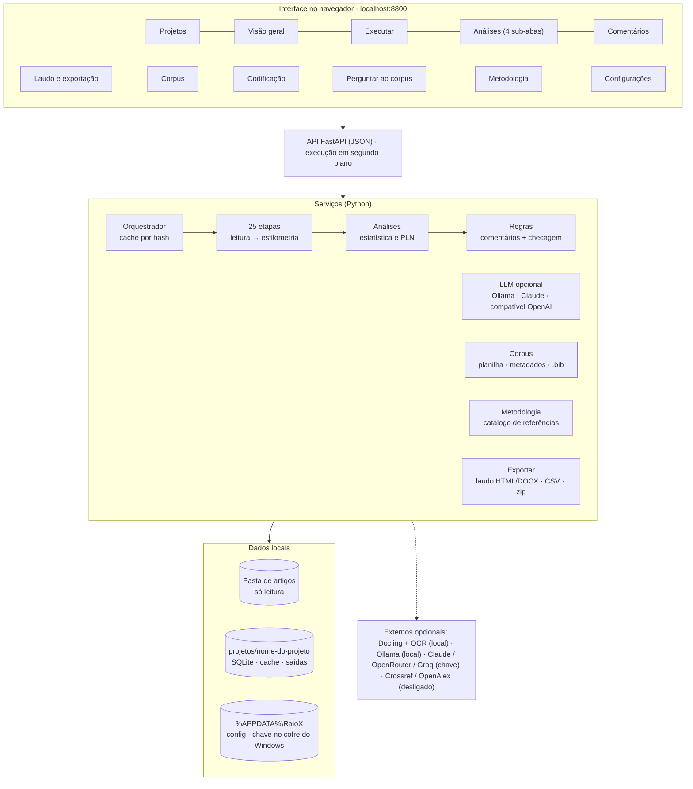
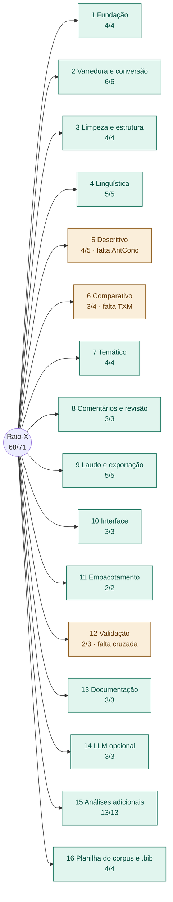

# Raio-X de Textos

Sistema **local** de análise textual de corpus para revisões de literatura (RSL/MLR) e pesquisa qualitativa. Você aponta uma pasta de artigos (PDF, DOCX, MD ou TXT) e recebe o raio-x do corpus:

- frequências, concordância (KWIC) e colocações;
- comparação entre grupos, classes de Reinert, AFC, tópicos e redes;
- comentários gerados por regras, revisados por você;
- laudo em HTML ou DOCX, texto de Métodos pronto para o artigo, planilha do corpus e `.bib` para o bibliometrix.

Cada número e cada comentário apontam para o trecho e a **página** de onde vieram.

> Plano, decisões e andamento: [EAP.md](EAP.md). Situação em 12/10/2026: MVP, v0.2, v0.3 e modo offline (v1.0) implementados (748 testes).

---

## Princípios

| | |
|---|---|
| **Local** | Roda no seu computador. A pasta de artigos é só lida, nunca alterada; tudo o que o sistema gera fica em `projetos/<nome>/`. |
| **Rastreável** | Toda métrica e todo comentário levam a evidência: documento, página e trecho. |
| **Reprodutível** | Os parâmetros ficam versionados no projeto, as análises usam semente fixa e o cache só recalcula o que mudou. |
| **Transparente** | Cada análise declara a métrica, a ferramenta equivalente (Voyant, AntConc, IRaMuTeQ, TXM, KH Coder…), com o que *não* deve ser confundida e as referências bibliográficas. |
| **Humano no controle** | Os comentários são gerados por regras, e o LLM é **opcional e vem desligado**. Nada entra no laudo sem o seu aceite, e números e citações são conferidos automaticamente antes. |

---

## Começo rápido

1. Instale o **Python 3.11 ou mais recente** ([python.org](https://www.python.org/downloads/)) e marque *Add python.exe to PATH* durante a instalação.
2. Dê dois cliques em **`iniciar.bat`**. Na primeira vez ele cria o ambiente (`.venv`) e instala as dependências. Depois abre http://localhost:8800.
3. Em **Projetos**, informe um nome e o caminho da pasta de artigos e clique em **Criar projeto**.
4. Na aba **Executar**, clique em **Executar** e acompanhe o progresso de cada etapa.
5. Explore as abas **Análises**, **Comentários** e **Laudo e exportação**.

### Componentes opcionais

| Para… | Rode | Observação |
|---|---|---|
| Ler **PDF/DOCX** (Docling) e fazer **OCR** de PDFs escaneados | `instalar_docling.bat` | Cerca de 2 GB (PyTorch CPU). Sem ele, o sistema lê `.md` e `.txt`. |
| Usar **classes gramaticais e entidades** (spaCy) | `instalar_spacy.bat` | Modelos pequenos em inglês e português, cerca de 15 MB cada. |
| Usar **LLM grátis e local** | instale o [Ollama](https://ollama.com) e, por exemplo, `ollama pull qwen2.5:7b` | Ative em **Configurações**. Nada sai da máquina. |
| Similaridade **semântica** (embeddings) | `ollama pull nomic-embed-text` | Requer o Ollama. |
| Instalar **sem internet** | `instalar_offline.bat` (pacote offline) | Gere o pacote com `scripts\preparar_offline.py`. Veja [docs/offline.md](docs/offline.md). |

Instalação em outro computador, atualização e problemas comuns: [docs/instalacao.md](docs/instalacao.md).

---

## Arquitetura



| Camada | O que tem |
|---|---|
| Interface | Página única em HTML/JS, sem dependências externas, com tema claro e escuro e selo "Offline" quando em modo offline |
| API | FastAPI: projetos, pipeline (com progresso), análises, comentários, laudo, corpus, codificação, busca, metodologia, LLM |
| Serviços | Orquestrador de 25 etapas com cache por hash; módulos de análise; motor de regras; LLM opcional com verificação; catálogo de métodos |
| Dados | A pasta de artigos só é lida; tudo o que o sistema gera fica em `projetos/<nome>/`; a configuração pessoal fica em `%APPDATA%\RaioX` |

## Fluxo de trabalho

```
Pasta de artigos ──► Executar ──► Análises ──► Comentários (regras ± LLM) ──► Revisão ──► Laudo / Métodos / Planilha / .bib
   (só leitura)        25 etapas, com cache                 checagem automática      você aceita, edita ou rejeita
```

O pipeline tem 25 etapas, em ordem. Cada uma só refaz o que mudou:

| Fase | Etapas |
|---|---|
| Leitura | varredura da pasta · metadados (`documentos.csv`) · conversão (Docling/OCR) · qualidade · duplicados |
| Preparação | limpeza (seções, referências, cabeçalhos) · linguística (lemas) · spaCy (opcional) · segmentos de ~40 palavras · ruído (tabelas, listas de autores) · vocabulário · termos compostos · quase-duplicatas |
| Análises | descritivo · comparativo (keyness) · similaridade · dicionário · especificidades · AFC · Reinert · similitude · tópicos · raio-x por documento · estilometria |
| Comentários | regras + checagem de evidência |

---

## O que o sistema faz

**Corpus e qualidade**
- Converte PDF e DOCX para Markdown com o número da página. Faz OCR por documento quando o PDF é escaneado.
- Detecta documentos vazios ou escaneados, idioma, duplicatas exatas e quase-duplicatas.
- Detecta as seções do artigo e exclui as referências das contagens. Remove cabeçalhos, URLs e ruído, como tabelas e listas de autores.
- Grupos (por exemplo, literatura acadêmica e cinzenta) e metadados podem ser editados na tela, vir de um `documentos.csv` ou do índice de downloads da revisão.

**Análises** (aba *Análises*, em quatro sub-abas)

| Sub-aba | Análises |
|---|---|
| Descritivo | Resumo do corpus (MATTR), Cirrus/Termos, Tendências, N-gramas, Contextos (KWIC com página e citação) |
| Comparativo | Keyness entre grupos (G², Log Ratio), keyness contra corpus de referência externo, Especificidades (Lafon), Similaridade (TF-IDF, Ward, MDS), Agrupamento (k-means, espectral, PCA), Dicionário/codebook, Estilometria (Delta de Burrows e variantes), Sentimento (léxico) |
| Temático | Classes de Reinert (como no IRaMuTeQ), AFC, Similitude e rede (Jaccard, árvore máxima, Louvain, centralidade), Tópicos (LSA, NMF, LDA, com coerência) |
| Associações | Links e Colocações (LL, MI, t-score, logDice), Termos compostos |

Por documento (*Visão geral → raio-x*): legibilidade (Flesch EN/PT, Gunning Fog, Coleman-Liau, SMOG), palavras-chave (RAKE, YAKE, TextRank) e resumo extrativo (TextRank, LexRank, MMR) com páginas.

**Comentários, laudo e exportações**
- **Comentários:** o catálogo de regras (`app/services/regras/catalogo.yaml`, editável) gera os comentários. Você aceita, edita, rejeita ou anota cada um, e uma checagem automática confere números e trechos.
- **Laudo:** em HTML (interativo, abre sem internet) ou em DOCX. Traz Métodos com as equivalências entre ferramentas e as referências em ABNT.
- **Texto de Métodos** pronto para o artigo, em português ou inglês, com referências em ABNT ou APA.
- **Planilha do corpus** (`.xlsx`): uma linha por documento e uma coluna por parte do artigo (objetivo, perguntas, método, resultados, limitações…), cada célula com trecho e página.
- **`.bib` para o bibliometrix**, no padrão Scopus, com referências citadas. Validado com `bibliometrix::convert2df` e a rede de cocitação.
- **Exportação para a planilha de coleta** da revisão. Gera um arquivo novo e marca os trechos que já constam na sua planilha.
- **CSV** de cada análise e **pacote .zip** com tudo.

**Coleta guiada por protocolo** (aba *Coleta*)
- Você define o protocolo: cada item é uma linha, com definição de **no máximo 2 frases** (a tela conta as frases e sugere o corte), tipo de resposta (texto, categoria, múltipla escolha, número, sim/não, data), onde procurar e palavras-chave. Importa CSV, XLSX ou tabela Markdown, exporta o protocolo e começa de modelos prontos ("Partes do artigo" e "Revisão sistemática (genérico)"). O protocolo é versionado no projeto.
- A coleta por regras preenche cada documento × item com trechos literais, página e origem; "não encontrado" quando não há evidência. É incremental e nunca sobrescreve o que você decidiu. Com o LLM ligado, ele só vale com frases copiadas do documento e conferidas.
- Na matriz documento × item você aceita, edita, rejeita ou marca "não se aplica" (por célula ou em lote), vê o contexto do trecho e acompanha o progresso por item. Exporta em planilha larga (valor + evidência) ou longa (um trecho por linha), em versão final (só aceitos) ou de auditoria, envia os aceitos à planilha de coleta da MLR e calcula kappa e alfa contra a sugestão automática ou um segundo codificador.

**LLM opcional** (*Configurações*): vem desligado. Os provedores possíveis são:
- Ollama, local e grátis;
- Claude, com chave guardada no cofre do Windows;
- endpoints compatíveis com OpenAI, como OpenRouter e Groq.

Com o LLM ligado, você pode usar:
- parágrafos adaptados a partir de modelos (*Exemplos de parágrafos*), com conferência de números e citações;
- extração de partes do artigo que só aceita frases literais do documento;
- codificação dos trechos como segundo codificador, com kappa de Cohen e alfa de Krippendorff;
- classificação zero-shot e few-shot;
- *Perguntar ao corpus*, com busca BM25 e respostas que citam (rótulo, p. N).

O laudo declara quando um texto foi redigido com LLM.

**Metodologia** (tela própria): 38+ análises com o que medem, métrica, parâmetros, equivalências, cuidados de interpretação e referências em ABNT, APA ou BibTeX. As referências marcadas "conferir antes de citar" foram compiladas de memória e precisam de conferência.

---

## Andamento (EAP)

Situação em 12/10/2026: **68 de 71 entregáveis concluídos** · 748 testes. Os 3 restantes são conferências externas que dependem do usuário.

> 🖥️ **Versão interativa**, com filtros por versão e situação: abra [docs/eap.html](docs/eap.html) no navegador. Para o que cada entregável faz, veja o [dicionário da EAP](docs/dicionario_eap.md).



| Versão | Concluídos | Progresso |
|---|---|---|
| MVP | 26 / 27 | `█████████░` 96% |
| v0.2 | 22 / 24 | `█████████░` 92% |
| v0.3 | 19 / 19 | `██████████` 100% |
| v1.0 | 1 / 1 | `██████████` 100% |

| Frente | Entregáveis | Situação |
|---|---|---|
| 1 Fundação | 1.1–1.4 | ✅ 4/4 |
| 2 Varredura e conversão | 2.1–2.6 | ✅ 6/6 |
| 3 Limpeza e estrutura | 3.1–3.4 | ✅ 4/4 |
| 4 Processamento linguístico | 4.1–4.5 | ✅ 5/5 |
| 5 Raio-x descritivo | 5.1–5.5 | 🟨 4/5 — 5.4 aguarda conferência no AntConc |
| 6 Raio-x comparativo | 6.1–6.4 | 🟨 3/4 — 6.2 aguarda conferência no TXM |
| 7 Raio-x temático | 7.1–7.4 | ✅ 4/4 |
| 8 Comentários e revisão | 8.1–8.3 | ✅ 3/3 |
| 9 Laudo e exportação | 9.1–9.5 | ✅ 5/5 |
| 10 Interface | 10.1–10.3 | ✅ 3/3 |
| 11 Empacotamento | 11.1–11.2 | ✅ 2/2 (falta testar em outra máquina) |
| 12 Validação | 12.1–12.3 | ⬜ 2/3 — 12.2 validação cruzada IRaMuTeQ/AntConc |
| 13 Documentação | 13.1–13.3 | ✅ 3/3 |
| 14 LLM opcional | 14.1–14.3 | ✅ 3/3 |
| 15 Análises adicionais | 15.1–15.13 | ✅ 13/13 |
| 16 Planilha do corpus e .bib | 16.1–16.4 | ✅ 4/4 |

## Documentação

| Documento | Para quê |
|---|---|
| [docs/guia_de_uso.md](docs/guia_de_uso.md) | Guia de uma página para quem não programa |
| [docs/instalacao.md](docs/instalacao.md) | Instalação, atualização, mudança de computador, problemas comuns |
| [docs/offline.md](docs/offline.md) | O que usa internet e como instalar e usar sem ela |
| [docs/nota_metodologica.md](docs/nota_metodologica.md) | Convenções estatísticas e referências |
| [docs/validacao_antconc.md](docs/validacao_antconc.md) | Como conferir colocações e keyness no AntConc |
| [docs/validacao_iramuteq.md](docs/validacao_iramuteq.md) | Como comparar Reinert e similitude com o IRaMuTeQ |
| [docs/dicionario_eap.md](docs/dicionario_eap.md) | Dicionário da EAP: o que cada entregável faz, como funciona e onde está, com glossário e índice "Quero... use" |
| [EAP.md](EAP.md) | Plano, decisões, entregáveis, riscos e histórico |
| [docs/eap.html](docs/eap.html) | EAP interativa (abre no navegador, sem internet) |

### Validação

| Análise | Conferida contra |
|---|---|
| AFC | Exemplo de Greenacre (autovalores 0,07476 / 0,01002 / 0,00041) |
| Alfa de Krippendorff | Exemplo publicado (α nominal = 0,743) |
| Estilometria | Pacote `stylo` do R (até 1e-9) |
| Colocações, keyness e especificidades | Implementações independentes e scipy; **falta** conferir no AntConc e no TXM |
| Reinert | Tópicos plantados e bipartição ótima por força bruta; **falta** comparar com o IRaMuTeQ |
| Coerência de tópicos | UMass idêntica ao gensim |
| `.bib` | Lido pelo bibliometrix 5.5 no R 4.6 |

---

## Onde ficam os arquivos

| Local | Conteúdo |
|---|---|
| Pasta de artigos | Seus arquivos. Só leitura. |
| `projetos/<nome>/` | `projeto.sqlite`, `parametros.json` (versionado), `cache/` e `saidas/` (laudos, CSV, xlsx, .bib) |
| `%APPDATA%\RaioX\` | Configuração do LLM, preços, léxicos importados. A chave de API fica no Cofre de Credenciais do Windows. |

O pacote de distribuição (`scripts/empacotar.py`) nunca inclui `projetos/`, chaves, configurações pessoais nem arquivos gerados a partir do seu corpus.

---

## Para desenvolvedores

```
python -m venv .venv
.venv\Scripts\python -m pip install -r requirements.txt
.venv\Scripts\python -m uvicorn app.main:app --port 8800
.venv\Scripts\python -m pytest -q          # suíte completa (~13 min)
```

```
raio-x/
├── app/
│   ├── main.py  config.py  database.py  models.py  schemas.py
│   ├── routers/        rotas da API (projetos, pipeline, análises, comentários, laudo, corpus, llm, busca…)
│   └── services/
│       ├── orquestrador.py         etapas registradas, cache por hash e alvo
│       ├── parametros.py           parametros.json versionado
│       ├── etapas/                 as 25 etapas do pipeline
│       ├── analises/               estatística e PLN (keyness, colocações, AFC, Reinert, tópicos…)
│       ├── regras/                 catálogo de regras, motor e checagem de evidência
│       ├── llm/                    provedores (Ollama, Anthropic, compatível OpenAI), verificação, cache de prompt
│       ├── concordancia/           codificação por LLM, kappa e alfa
│       ├── corpus/                 metadados, planilha do corpus, referências, .bib
│       ├── busca/                  BM25, embeddings, RAG
│       ├── metodologia/            catálogo único de métodos e referências
│       └── exportar/               laudo HTML/DOCX, CSV, pacote
├── frontend/           página única em HTML/JS sem dependências externas
├── tests/              suíte pytest (inclui tests/corpus_referencia)
├── scripts/            empacotar, pacote offline, medir desempenho, revisar limpeza
├── docs/
└── projetos/<nome>/    (ignorado pelo git)
```

- `RAIOX_PROJETOS_DIR` e `RAIOX_CONFIG_DIR` trocam as pastas de projetos e de configuração (usado nos testes).
- `RAIOX_OFFLINE=1` liga o modo offline (também ligado pelo arquivo `raiox_offline.flag`); `0` desliga. Veja [docs/offline.md](docs/offline.md).
- Para criar uma etapa nova, veja a docstring de `app/services/orquestrador.py`. Declare `parametros_relevantes` e `depende_de` para manter o cache correto.
- As referências bibliográficas têm uma fonte só: `app/services/metodologia/catalogo.yaml`.

---

## Limitações conhecidas

- **Padrões da planilha do corpus:** os padrões de linguagem (objetivo, limitações) são heurísticos. Confira as células antes de citar.
- **Classes de Reinert:** não batem uma a uma com as do IRaMuTeQ, porque ramos muito pequenos são descartados (veja a nota metodológica).
- **Sentimento por léxico:** em texto acadêmico é só exploratório, e os léxicos em português precisam ser importados por você.
- **Lematização:** a `simplemma` pode errar em termos técnicos. Use as exceções nos parâmetros ou o spaCy.
- **Estilometria:** neste tipo de corpus reflete gênero e idioma, não autoria.
