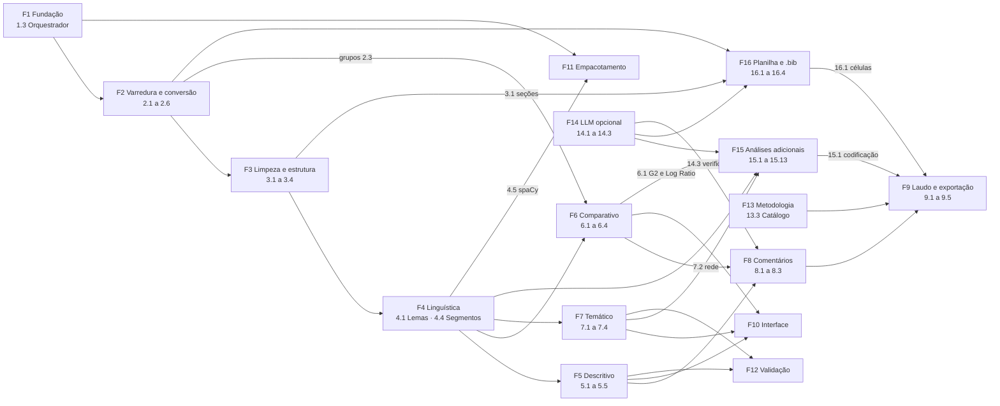

# Dicionário da EAP do Raio-X de Textos

> Explica, entregável por entregável, tudo o que o sistema faz. Escrito para pesquisadoras e pesquisadores, não para programadores. Data de referência: **12/10/2026**. Fonte primária: `EAP.md`; também `app/services/metodologia/catalogo.yaml`, o código em `app/` e a interface em `frontend/`.

## Sumário

1. [Introdução](#1-introdução)
2. [Visão geral do sistema e as 16 frentes](#2-visão-geral-do-sistema-e-as-16-frentes)
3. Entregáveis, por frente:
   - [Frente 1 — Fundação](#frente-1--fundação) (1.1 a 1.4)
   - [Frente 2 — Varredura e conversão](#frente-2--varredura-e-conversão) (2.1 a 2.6)
   - [Frente 3 — Limpeza e estrutura](#frente-3--limpeza-e-estrutura) (3.1 a 3.4)
   - [Frente 4 — Processamento linguístico](#frente-4--processamento-linguístico) (4.1 a 4.5)
   - [Frente 5 — Raio-x descritivo](#frente-5--raio-x-descritivo) (5.1 a 5.5)
   - [Frente 6 — Raio-x comparativo](#frente-6--raio-x-comparativo) (6.1 a 6.4)
   - [Frente 7 — Raio-x temático](#frente-7--raio-x-temático) (7.1 a 7.4)
   - [Frente 8 — Comentários por regra e revisão](#frente-8--comentários-por-regra-e-revisão) (8.1 a 8.3)
   - [Frente 9 — Laudo e exportação](#frente-9--laudo-e-exportação) (9.1 a 9.5)
   - [Frente 10 — Interface](#frente-10--interface) (10.1 a 10.3)
   - [Frente 11 — Empacotamento](#frente-11--empacotamento) (11.1 a 11.2)
   - [Frente 12 — Validação](#frente-12--validação) (12.1 a 12.3)
   - [Frente 13 — Documentação](#frente-13--documentação) (13.1 a 13.3)
   - [Frente 14 — LLM opcional (redação assistida)](#frente-14--llm-opcional-redação-assistida) (14.1 a 14.3)
   - [Frente 15 — Análises adicionais](#frente-15--análises-adicionais) (15.1 a 15.13)
   - [Frente 16 — Planilha do corpus e exportação bibliográfica](#frente-16--planilha-do-corpus-e-exportação-bibliográfica) (16.1 a 16.4)
4. [Glossário](#4-glossário)
5. [Índice remissivo rápido](#5-índice-remissivo-rápido-quero-use)
6. [Mapa de dependências](#6-mapa-de-dependências)

## 1. Introdução

**O que é um dicionário da EAP.** A EAP (Estrutura Analítica do Projeto) divide o Raio-X em frentes e entregáveis numerados (1.1, 1.2, ..., 16.4). Este dicionário descreve cada entregável com a mesma ficha: o que faz, como funciona, o que consome e produz, onde está no código e na tela, de que depende, como se sabe que está pronto e quais cuidados a interpretação exige. O plano em si (decisões, riscos, histórico) continua no `EAP.md`; aqui está o "para que serve cada peça".

**Como ler uma ficha.**

| Campo | Para que serve |
|---|---|
| Frente | A qual das 16 frentes o entregável pertence |
| Release / Status | Em que versão entrou e se está concluído |
| O que faz | Explicação em linguagem comum |
| Como funciona | Método, algoritmo ou convenção, com parâmetros padrão |
| Entradas / Saídas | O que o entregável consome e o que produz (tabelas, arquivos de cache, JSON da API, telas, arquivos exportados) |
| Onde está | Módulo (caminho), etapa do pipeline (nome e ordem), rota da API e tela, aba ou botão |
| Depende de | Outros entregáveis (IDs) que precisam estar prontos |
| Critério de aceite / evidência | Como o EAP comprova que o entregável cumpre o objetivo |
| Equivale a / não é igual a | Para análises: ferramenta equivalente e o que se parece mas não é a mesma coisa |
| Referências | Autores e anos do catálogo de metodologia (referências completas na tela Metodologia) |
| Cuidados | Limites e armadilhas de interpretação |

Onde um campo não se aplica, aparece "—". Quando algo não foi localizado no código, a ficha diz "não localizado".

**Legenda de status.** ✅ concluído · 🟨 em andamento (quase pronto; o que falta está na ficha) · ⬜ planejado. No EAP também existe ⛔ (bloqueado), sem uso hoje.

**Releases.**

| Release | Significado | Situação em 12/10/2026 |
|---|---|---|
| MVP (v0.1) | Frentes 1 a 6 mais comentários por regra e laudo HTML/CSV, sem LLM | 26 de 27 concluídos (falta 5.4, conferência no AntConc) |
| v0.2 | Temático, n-gramas, OCR, DOCX, métodos, metodologia, LLM opcional e empacotamento | 23 de 24 concluídos (falta 6.2, conferência no TXM; 12.2 feita em R em 14/10/2026) |
| v0.3 | spaCy, tópicos, planilha do corpus, .bib, análises adicionais | 21 de 21 concluídos |
| v1.0 | Modo offline | 0 de 1 (11.2) |

Pendências que dependem do usuário: 5.4 (AntConc) e 6.2 (TXM), já conferidas em R na 12.2, e o teste do zip em outra máquina (11.1). Princípios do sistema: rastreabilidade (todo número aponta para documento, página e trecho), transparência metodológica, reprodutibilidade, comentário automático é só sugestão até a revisão humana, e execução 100% local.

## 2. Visão geral do sistema e as 17 frentes

O Raio-X de Textos é um sistema local que lê uma **pasta de artigos** (PDF, DOCX, MD ou TXT), converte tudo para texto, limpa, lematiza e roda um conjunto de análises de linguística de corpus e de análise de dados textuais (frequências, concordâncias, colocações, palavras-chave entre grupos, classes de Reinert, redes, tópicos, estilometria e outras). Em seguida gera **comentários por regras**, que uma pessoa revisa (aceitar, editar, rejeitar), e produz um **laudo** (HTML e DOCX) em que cada afirmação aponta para a evidência com página. O LLM é opcional e vem desligado; nenhum dado sai do computador por padrão. Tudo roda em um servidor local (`http://localhost:8800`) com interface no navegador; a pasta de artigos nunca é alterada.

1. **Fundação**: Repositório, banco de dados, orquestrador com cache e parâmetros versionados.
2. **Varredura e conversão**: Ler a pasta de artigos, extrair metadados, grupos, converter PDFs, controlar qualidade e OCR.
3. **Limpeza e estrutura**: Detectar seções, tirar referências, cabeçalhos, URLs e ruído.
4. **Processamento linguístico**: Lematizar, palavras vazias, termos compostos, segmentos e classes gramaticais.
5. **Raio-x descritivo**: Resumo, frequências, concordância (KWIC), colocados e n-gramas.
6. **Raio-x comparativo**: Keyness, especificidades, similaridade entre documentos e dicionário por grupo.
7. **Raio-x temático**: Classes de Reinert, similitude e redes, AFC e tópicos.
8. **Comentários por regra e revisão**: Comentários automáticos por regras, revisão humana e checagem de evidência.
9. **Laudo e exportação**: Laudo HTML e DOCX, CSV, texto de Métodos e planilha de coleta.
10. **Interface**: Telas de projetos, painéis de análise e sub-abas.
11. **Empacotamento**: Pacote para outra máquina e modo offline.
12. **Validação**: Corpus de referência, validação cruzada e desempenho.
13. **Documentação**: Guia de uso, nota metodológica e tela de metodologia.
14. **LLM opcional (redação assistida)**: Configuração do provedor, modelos de parágrafo e geração conferida.
15. **Análises adicionais**: Concordância humano x LLM, redes, legibilidade, palavras-chave, estilometria, tópicos, sentimento, busca e RAG.
16. **Planilha do corpus e exportação bibliográfica**: Planilha por partes do artigo, extração por LLM, .bib para o bibliometrix e metadados.

**Ordem das etapas do pipeline** (cada etapa roda por documento ou sobre o corpus inteiro; as de corpus recalculam quando qualquer documento muda):

| Ordem | Etapa | Escopo | Entregável |
|---|---|---|---|
| 10 | `varredura` | corpus | 2.1 |
| 11 | `metadados_csv` | corpus | 2.3 |
| 20 | `conversao` | documento | 2.4, 2.6 |
| 25 | `qualidade` | documento | 2.5 |
| 26 | `qualidade_duplicados` | corpus | 2.5 |
| 30 | `limpeza` | documento | 3.1, 3.2, 3.3 |
| 40 | `linguistica` | documento | 4.1 |
| 41 | `spacy` | documento | 4.5 |
| 42 | `segmentos` | documento | 4.4 |
| 43 | `ruido` | corpus | 3.4 |
| 45 | `vocabulario` | corpus | 4.2 |
| 46 | `termos_compostos` | corpus | 4.3 |
| 47 | `duplicatas_proximas` | corpus | 2.5 |
| 50 | `descritivo` | corpus | 5.1, 5.2 |
| 60 | `comparativo` | corpus | 6.1 |
| 62 | `similaridade` | corpus | 6.3 |
| 63 | `dicionario` | corpus | 6.4 |
| 64 | `especificidades` | corpus | 6.2 |
| 65 | `afc` | corpus | 7.3 |
| 66 | `reinert` | corpus | 7.1 |
| 67 | `similitude` | corpus | 7.2, 15.2 |
| 68 | `topicos` | corpus | 7.4, 15.7 |
| 69 | `documento_extra` | corpus | 15.3, 15.4, 15.5 |
| 69 | `estilometria` | corpus | 15.6 |
| 70 | `comentarios` | corpus | 8.1, 8.3 |

As demais análises (KWIC, colocações, n-gramas, agrupamento k-means, sentimento, codificação, classificação, busca) são calculadas sob demanda pela API, a partir dos arquivos de cache. Por convenção, as rotas usam o prefixo `/api/projetos/{slug}`, onde `{slug}` é o identificador do projeto.

## Frente 1 — Fundação

_Repositório, banco de dados, orquestrador com cache e parâmetros versionados._

### 1.1 — Estrutura do repositório e `iniciar.bat`

| Campo | Descrição |
|---|---|
| Frente | 1. Fundação |
| Release / Status | MVP · ✅ |
| O que faz | Organiza o código do Raio-X em pastas previsíveis (servidor, interface, testes, documentação) e traz um atalho de duplo clique que prepara tudo e abre o sistema no navegador. É a base sobre a qual todo o resto roda. |
| Como funciona | Segue as convenções do `rsl-ia-system` (D4): backend em FastAPI com `app/routers` (rotas) e `app/services` (regras de negócio), interface em HTML/JS estático servida pelo próprio FastAPI na porta 8800. O `iniciar.bat` cria o ambiente virtual na primeira vez e verifica Python 3.11 ou superior. |
| Entradas | Python 3.11+, `requirements.txt`. |
| Saídas | Servidor local em `http://localhost:8800`; ambiente virtual `.venv`; página inicial com as abas do sistema. |
| Onde está | `iniciar.bat`, `app/main.py`, `app/config.py`, `frontend/index.html`; rota `GET /api` (estado do servidor). |
| Depende de | — |
| Critério de aceite / evidência | Sobe o servidor vazio em máquina limpa; servidor testado na porta 8800. |
| Equivale a / não é igual a | — |
| Referências | — |
| Cuidados | Pasta do projeto não pode ter o venv movido entre máquinas; ver `docs/instalacao.md`. |

### 1.2 — Modelo de dados SQLite e criação de projeto

| Campo | Descrição |
|---|---|
| Frente | 1. Fundação |
| Release / Status | MVP · ✅ |
| O que faz | Define onde o sistema guarda o que sabe sobre cada corpus (documentos, execuções, comentários) e permite criar um projeto apontando para a pasta onde estão os artigos. A pasta de artigos nunca é alterada: tudo o que o sistema gera fica dentro de `projetos/<nome>/`. |
| Como funciona | Um banco SQLite por projeto (`projeto.sqlite`) com tabelas para projeto, documento, execução, análise (resultado em JSON), comentário e evidência, mais um arquivo `parametros.json`. O projeto recebe um identificador curto (slug) usado em todas as rotas. |
| Entradas | Nome do projeto e caminho da pasta de artigos. |
| Saídas | Pasta `projetos/<slug>/` com `projeto.sqlite`, `parametros.json`, `cache/` e `saidas/`. |
| Onde está | `app/models.py`, `app/database.py`, `app/schemas.py`, `app/routers/projetos.py`; `POST /api/projetos`, `GET /api/projetos`, `GET /api/projetos/{slug}`; tela Projetos (formulário Novo projeto). |
| Depende de | 1.1 |
| Critério de aceite / evidência | Teste cria projeto e tabelas (`test_criar_projeto_*`). |
| Equivale a / não é igual a | — |
| Referências | — |
| Cuidados | Mover a pasta de artigos de lugar exige recriar ou editar o projeto. |

### 1.3 — Orquestrador do pipeline com cache por hash

| Campo | Descrição |
|---|---|
| Frente | 1. Fundação |
| Release / Status | MVP · ✅ |
| O que faz | Executa as etapas de análise na ordem certa e só refaz o que realmente mudou: se você rodar de novo sem alterar nada, o sistema pula tudo em segundos. Cada etapa grava no banco quando começou, terminou e se deu certo. |
| Como funciona | Cada etapa tem nome, ordem, escopo (por documento ou sobre o corpus inteiro) e uma função. A chave de cache é um hash (SHA-256) de arquivo + parâmetros relevantes + versão da etapa; uma etapa é pulada só se a última execução do mesmo alvo terminou bem com a mesma chave. Existe também a execução em segundo plano com progresso por etapa. |
| Entradas | Pasta do projeto, `parametros.json`, lista opcional de etapas. |
| Saídas | Registros na tabela de execuções; resumo (executadas, puladas, erros); progresso consultável. |
| Onde está | `app/services/orquestrador.py`, `app/services/execucao_bg.py`, `app/services/etapas/__init__.py`; `POST /api/projetos/{slug}/executar` (202 + run_id; `?sincrono=1` espera o fim), `GET .../progresso`, `GET .../execucoes`, `GET .../documentos`; aba Executar. |
| Depende de | 1.2, 1.4 |
| Critério de aceite / evidência | Reexecução sem mudanças não reprocessa (`test_orquestrador_*`); corpus MLR: 22 s na primeira execução, 4 s na segunda. |
| Equivale a / não é igual a | — |
| Referências | — |
| Cuidados | O cache compara só com a última execução do mesmo alvo (corrigido em 10/10/2026 para não deixar arquivos de versão antiga ao ligar, desligar e ligar um parâmetro). |

### 1.4 — `parametros.json` versionado no projeto

| Campo | Descrição |
|---|---|
| Frente | 1. Fundação |
| Release / Status | MVP · ✅ |
| O que faz | Guarda todas as escolhas metodológicas do projeto (idiomas, lematização, palavras vazias, janelas, número de classes etc.) em um único arquivo. Assim, a mesma pasta com os mesmos parâmetros dá o mesmo laudo. |
| Como funciona | Cada alteração incrementa a versão, registra o histórico e calcula um hash do conteúdo; os padrões ficam em `PADRAO` (ex.: `kwic_janela` = 10, `colocacao_janela` = 5, `segmento_palavras` = 40, `reinert.classes` = 10, `topicos.k` = 8 e semente 42). Fornece os "parâmetros relevantes" que compõem a chave de cache. |
| Entradas | Valores informados pelo usuário (PUT) ou padrões. |
| Saídas | `parametros.json` com versão, histórico e hash; parâmetros e hash registrados no laudo. |
| Onde está | `app/services/parametros.py`; `GET /api/projetos/{slug}/parametros`, `PUT /api/projetos/{slug}/parametros`; aba Executar (parâmetros). |
| Depende de | 1.2 |
| Critério de aceite / evidência | Versão + histórico + hash (`test_parametros_*`). |
| Equivale a / não é igual a | — |
| Referências | — |
| Cuidados | Mudar um parâmetro invalida apenas as etapas que o leem. |

## Frente 2 — Varredura e conversão

_Ler a pasta de artigos, extrair metadados, grupos, converter PDFs, controlar qualidade e OCR._

### 2.1 — Varredura da pasta (novos, alterados, removidos)

| Campo | Descrição |
|---|---|
| Frente | 2. Varredura e conversão |
| Release / Status | MVP · ✅ |
| O que faz | Lê a pasta de artigos e descobre o que mudou desde a última vez: arquivos novos, alterados, removidos ou iguais. Só o que mudou é reprocessado, e a pasta original nunca é modificada. |
| Como funciona | Lista os arquivos aceitos (PDF, DOCX, MD, TXT), calcula o SHA-256 de cada um e compara com o banco. É a etapa 1 do pipeline e nunca é pulada, porque precisa olhar a pasta de novo a cada execução. |
| Entradas | Pasta de artigos do projeto. |
| Saídas | Registros de documento no SQLite com hash e situação (novo, alterado, removido, sem mudança). |
| Onde está | `app/services/etapas/varredura.py` (etapa `varredura`, ordem 10, corpus); `POST /api/projetos/{slug}/executar`; aba Executar e Visão geral (lista de documentos). |
| Depende de | 1.3 |
| Critério de aceite / evidência | Adicionar 1 arquivo reprocessa só ele; corpus MLR: 52 novos e depois 52 sem mudança. |
| Equivale a / não é igual a | — |
| Referências | — |
| Cuidados | Arquivos renomeados contam como removido + novo. |

### 2.2 — Metadados pelo nome do arquivo e edição manual

| Campo | Descrição |
|---|---|
| Frente | 2. Varredura e conversão |
| Release / Status | MVP · ✅ |
| O que faz | Extrai do nome do arquivo (por exemplo `001_2026_Kim_Hyunso_Titulo.pdf`) o número de identificação, o ano e o sobrenome do autor (tokens como `QP1` são ignorados), e permite corrigir esses dados à mão. Esses metadados alimentam filtros e comparações por ano. |
| Como funciona | A função `parse_nome` (mesma regra do protótipo `voyant-local`) lê id numérico opcional, ano (19xx/20xx) opcional e o sobrenome; sem id nem ano não há metadados confiáveis e o que não casa fica em branco para edição. A correção manual é feita por PATCH no documento ou na tabela de documentos da interface. |
| Entradas | Nome do arquivo; edição do usuário. |
| Saídas | Campos id_estudo, ano e autor do documento no SQLite. |
| Onde está | `app/services/etapas/varredura.py` (`parse_nome`); `PATCH /api/projetos/{slug}/documentos/{documento_id}`; Visão geral > Documentos (edição inline). |
| Depende de | 2.1 |
| Critério de aceite / evidência | 51 de 52 documentos da MLR com metadados corretos; edição manual funciona (PATCH + interface). |
| Equivale a / não é igual a | — |
| Referências | — |
| Cuidados | O enriquecimento a partir do texto e do índice de downloads é a entrega 16.4. |

### 2.3 — Grupo do documento (acadêmica, cinzenta etc.)

| Campo | Descrição |
|---|---|
| Frente | 2. Varredura e conversão |
| Release / Status | MVP · ✅ |
| O que faz | Permite classificar cada documento em um grupo (por exemplo literatura acadêmica ou cinzenta). Os grupos são a base das comparações da Frente 6. |
| Como funciona | O grupo vem de uma coluna do `documentos.csv` (etapa `metadados_csv`), de upload na interface ou de edição individual. A listagem de grupos mostra o tamanho de cada um. |
| Entradas | `documentos.csv` (arquivo; id_estudo; grupo; QP), PATCH ou botão "Enviar CSV". |
| Saídas | Campo `grupo` do documento; lista de grupos. |
| Onde está | `app/services/etapas/metadados_csv.py` (etapa `metadados_csv`, ordem 11, corpus); `app/routers/documentos.py`: `PATCH /api/projetos/{slug}/documentos/{documento_id}`, `GET .../grupos`, `POST .../documentos-csv`; botão "Enviar CSV" na Visão geral. |
| Depende de | 2.1, 2.2 |
| Critério de aceite / evidência | Grupos usados na Frente 6 (PATCH, CSV, upload e `/grupos`). |
| Equivale a / não é igual a | — |
| Referências | — |
| Cuidados | Sem grupo, a keyness (6.1) não tem o que comparar. |

### 2.4 — Conversão Docling para Markdown com marcador de página

| Campo | Descrição |
|---|---|
| Frente | 2. Varredura e conversão |
| Release / Status | MVP · ✅ |
| O que faz | Transforma PDFs e documentos do Word em texto limpo em formato Markdown, mantendo em cada página um marcador `<!-- página N -->`. É esse marcador que permite citar a página exata de qualquer trecho. |
| Como funciona | Usa o Docling (modelos de leitura de layout) para PDF/DOCX; arquivos MD e TXT entram direto. O resultado é gravado em cache por documento, então só é refeito se o arquivo ou os parâmetros de conversão mudarem. |
| Entradas | Arquivos da pasta (PDF, DOCX, MD, TXT); parâmetro `conversao.ocr`. |
| Saídas | `cache/md/<id>.md` com marcadores de página. |
| Onde está | `app/services/etapas/conversao.py` (etapa `conversao`, ordem 20, documento); executada por `POST /api/projetos/{slug}/executar`; aba Executar. |
| Depende de | 2.1 |
| Critério de aceite / evidência | Mesma saída do `Corpus_Docling` da MLR: MD copiado 52/52 e 3 PDFs reais convertidos com Docling. |
| Equivale a / não é igual a | — |
| Referências | Auer et al., 2024 |
| Cuidados | O Docling pode extrair 0 caracteres de PDFs com camada de texto inútil (ver 2.6); instalação pesada, por isso é opcional (`instalar_docling.bat`). |

### 2.5 — Controle de qualidade, duplicatas e pendências

| Campo | Descrição |
|---|---|
| Frente | 2. Varredura e conversão |
| Release / Status | MVP · ✅ |
| O que faz | Confere se cada documento tem texto, se parece escaneado, em que idioma está e se é cópia de outro. O que falha vai para uma lista de pendências, e você decide se o documento fica ou sai da análise. |
| Como funciona | Três verificações: qualidade por documento (vazio, escaneado, idioma), duplicata exata (SHA-256 igual ou título normalizado idêntico) e duplicata próxima (cosseno TF-IDF maior ou igual a 0,95 sobre os lemas). O sistema só avisa: `PATCH ... {"excluido": true}` tira o documento das análises, e `false` o devolve. |
| Entradas | Markdown convertido; lemas (para duplicata próxima); parâmetro `idioma`. |
| Saídas | Avisos por documento; lista de pendências; flag `excluido`. |
| Onde está | `app/services/etapas/qualidade.py` (etapas `qualidade`, ordem 25, e `qualidade_duplicados`, ordem 26), `app/services/etapas/duplicatas.py` (etapa `duplicatas_proximas`, ordem 47); `GET /api/projetos/{slug}/pendencias`, `PATCH .../documentos/{documento_id}`; Visão geral > Pendências (botões "Excluir da análise" e "Reincluir"). |
| Depende de | 2.4, 4.1 |
| Critério de aceite / evidência | Detecta o R063 como vazio; idiomas 005=es, 008/011=pt; 002/013 (Cai 2025) sinalizados por texto (1,00) e 017/038 por título, sem falsos positivos. |
| Equivale a / não é igual a | — |
| Referências | Salton & Buckley, 1988; Manning et al., 2008 |
| Cuidados | A exclusão é decisão do usuário e reversível; documentos excluídos não entram nas comparações; um apêndice inteiro (029) fica sem texto de corpo e recebe aviso. |

### 2.6 — OCR opcional para PDFs escaneados

| Campo | Descrição |
|---|---|
| Frente | 2. Varredura e conversão |
| Release / Status | v0.2 · ✅ |
| O que faz | Reconhece o texto de PDFs que são só imagem (digitalizações) ou cuja camada de texto não é utilizável. Funciona documento a documento: você escolhe quais reconverter com OCR. |
| Como funciona | Motor RapidOCR com onnxruntime (roda em CPU, offline). O override `documento.ocr` (verdadeiro, falso ou nulo para seguir o projeto) entra na chave de cache só daquele documento. Forçado, faz OCR de página inteira; ligado só pelo projeto, usa o modo padrão do Docling (só regiões sem texto). Medido: 256 s para 32 páginas no R063. |
| Entradas | PDF marcado "sem texto" ou "provável escaneado"; idioma do projeto (o primeiro de `idioma`). |
| Saídas | Markdown reconvertido; qualidade reavaliada. |
| Onde está | `app/services/etapas/conversao.py`; `PATCH /api/projetos/{slug}/documentos/{documento_id}` com `{"ocr": ...}`; botão "Reconverter com OCR" nas pendências; instalação por `instalar_docling.bat`. |
| Depende de | 2.4, 2.5 |
| Critério de aceite / evidência | PDF escaneado de teste gera texto; R063 (Federal Reserve): 0 caracteres sem OCR e 39.459 com OCR forçado. |
| Equivale a / não é igual a | — |
| Referências | Auer et al., 2024 |
| Cuidados | OCR lento (~8 s por página em CPU) e ruidoso ("AI" sai como "Al"); motor ausente gera o problema "OCR não instalado"; ver riscos na seção 9 do EAP. |

## Frente 3 — Limpeza e estrutura

_Detectar seções, tirar referências, cabeçalhos, URLs e ruído._

### 3.1 — Detecção de seções

| Campo | Descrição |
|---|---|
| Frente | 3. Limpeza e estrutura |
| Release / Status | MVP · ✅ |
| O que faz | Identifica onde começam e terminam resumo, introdução, métodos, resultados, referências e apêndices em cada documento. Isso permite, por exemplo, ignorar a lista de referências nas contagens. |
| Como funciona | Procura títulos de seção conhecidos no Markdown; quando não há título, usa uma heurística que reconhece o bloco final de referências. A heurística acerta o tamanho certo em cerca de 73% dos casos validados. |
| Entradas | Markdown convertido. |
| Saídas | Seções por documento (nome, páginas, tamanho) e flag de bloco excluído. |
| Onde está | `app/services/etapas/limpeza.py` (etapa `limpeza`, ordem 30, documento), `app/services/limpeza_texto.py`; `GET /api/projetos/{slug}/documentos/{documento_id}/secoes`; Visão geral > Documentos > Seções. |
| Depende de | 2.4 |
| Critério de aceite / evidência | Corpus MLR: 48/51 por título e 3 sem referências (011, 029, 051); amostra de 10 documentos: 10/10 corretos. |
| Equivale a / não é igual a | — |
| Referências | Denny & Spirling, 2018 |
| Cuidados | Confira o painel de seções em documentos de literatura cinzenta; decisões de pré-processamento alteram os resultados. |

### 3.2 — Exclusão das referências da contagem

| Campo | Descrição |
|---|---|
| Frente | 3. Limpeza e estrutura |
| Release / Status | MVP · ✅ |
| O que faz | Tira a lista de referências (e outras seções escolhidas) das contagens, para que "et al.", "doi" e nomes de revistas não dominem os rankings de palavras. |
| Como funciona | Parâmetros `excluir_referencias` (padrão ligado) e `excluir_secoes` (referências, apêndice, agradecimentos, declarações). Remove em média 35% dos tokens do corpus MLR (707 mil para 437 mil). "et" e "al" das citações no corpo saem pela lista de palavras vazias acadêmicas (4.2). |
| Entradas | Seções detectadas (3.1); `parametros.json`. |
| Saídas | Marcação `incluir` por token; contagens só do corpo. |
| Onde está | `app/services/etapas/limpeza.py`, `app/services/limpeza_texto.py`; parâmetros `excluir_referencias` e `excluir_secoes`. |
| Depende de | 3.1, 4.2 |
| Critério de aceite / evidência | "et al" some do top 100; `arxiv`, `https`, `doi` e `pp` também (corpus MLR, 51 docs). |
| Equivale a / não é igual a | — |
| Referências | Denny & Spirling, 2018 |
| Cuidados | Em documentos sem seção detectada, referências podem sobrar nas contagens. |

### 3.3 — Remoção de cabeçalho, rodapé, URLs e hifenização

| Campo | Descrição |
|---|---|
| Frente | 3. Limpeza e estrutura |
| Release / Status | v0.2 · ✅ |
| O que faz | Limpa o que não é conteúdo do texto: cabeçalhos e rodapés repetidos a cada página, números de página, URLs, e-mails, DOI e hifens de quebra de linha. Uma amostra revisada à mão confirma que a limpeza não estraga o texto. |
| Como funciona | Linhas repetidas em pelo menos 50% das páginas (em documentos de 4 páginas ou mais) saem; palavras partidas por hífen no fim da linha são reunidas (inclusive na virada de página), preservando prefixos reais como "non-experimental". O script `scripts/revisar_limpeza.py` gera `docs/revisao_limpeza.md` com antes e depois de uma amostra com semente fixa. |
| Entradas | Markdown convertido. |
| Saídas | Texto limpo por bloco; relatório de revisão em `docs/revisao_limpeza.md`. |
| Onde está | `app/services/limpeza_texto.py`, `app/services/etapas/limpeza.py`, `scripts/revisar_limpeza.py`; `GET /api/projetos/{slug}/documentos/{documento_id}/texto`; botão "Ver texto limpo". |
| Depende de | 3.1 |
| Critério de aceite / evidência | Amostra de 10 documentos do MLR mais o 063 com OCR: cabeçalhos, números de página e fronteira das referências corretos (9/9); bugs achados foram corrigidos com teste. A conferência humana do checklist continua com o usuário. |
| Equivale a / não é igual a | — |
| Referências | Denny & Spirling, 2018 |
| Cuidados | Ruído do OCR permanece (ver 2.6). |

### 3.4 — Detector de segmentos de ruído

| Campo | Descrição |
|---|---|
| Frente | 3. Limpeza e estrutura |
| Release / Status | v0.2 · ✅ |
| O que faz | Marca trechos que não são prosa (listas de autores, tabelas de regressão, frases repetidas em vários documentos) para que não distorçam classes, redes e n-gramas. Mostra quantos trechos foram marcados em cada documento. |
| Como funciona | Regras conservadoras por segmento: fração numérica ou de símbolos (tabela), maiúsculas com poucas palavras de prosa e separadores (autores), baixa razão tipo/ocorrência (repetitivo) e 6-gramas presentes em 4 ou mais documentos (cláusula repetida). Com `limpeza.excluir_ruido` ligado (padrão), os marcados saem da CHD, da similitude e dos n-gramas. |
| Entradas | Segmentos de texto (4.4); parâmetros `limpeza.ruido`. |
| Saídas | Segmentos marcados com motivo; contagem por documento nas pendências; selo "ruído" no KWIC. |
| Onde está | `app/services/ruido.py`, `app/services/etapas/ruido.py` (etapa `ruido`, ordem 43, corpus); Visão geral > Pendências; painel Contextos. |
| Depende de | 4.4 |
| Critério de aceite / evidência | Corpus MLR: 166 de 11.388 segmentos marcados (1,5%): 92 tabela, 70 autores, 4 repetitivo; retenção da CHD sobe de 90,76% para 92,22%. |
| Equivale a / não é igual a | — |
| Referências | — |
| Cuidados | Tabelas com muito texto nas células e listas de autores com poucas vírgulas escapam; nomes de autores em citações dentro de prosa ainda deixam resíduo. |

## Frente 4 — Processamento linguístico

_Lematizar, palavras vazias, termos compostos, segmentos e classes gramaticais._

### 4.1 — Tokenização e lematização EN/PT/ES

| Campo | Descrição |
|---|---|
| Frente | 4. Processamento linguístico |
| Release / Status | MVP · ✅ |
| O que faz | Separa o texto em palavras e leva cada uma à forma de dicionário (o lema): "agents" e "agent" contam como o mesmo termo. A forma original sempre continua visível e há uma chave para alternar entre lema e forma. |
| Como funciona | Lematização por tabela de consulta (`simplemma`), idioma detectado por documento (en, pt, es), lista de exceções para erros conhecidos ("growing" não vira "growe"), siglas em caixa alta preservadas e opção `lematizacao.ativa=false`. Gera arrays paralelos (forma, normalizada, lema, página, seção, bloco, posição) em cache. |
| Entradas | Texto limpo; parâmetros `lematizacao` e `idioma`. |
| Saídas | `cache/tokens/<id>.json`. |
| Onde está | `app/services/tokenizacao.py`, `app/services/etapas/linguistica.py` (etapa `linguistica`, ordem 40, documento); `GET /api/projetos/{slug}/documentos/{documento_id}/tokens`. |
| Depende de | 3.1 |
| Critério de aceite / evidência | agent/agents resultam em *agent*; corpus MLR: 51 docs e 427 mil tokens contados em ~5 s. |
| Equivale a / não é igual a | — |
| Referências | Denny & Spirling, 2018; Honnibal et al., 2020 |
| Cuidados | Erros de lema em termos técnicos são conhecidos; no máximo 0,85% dos tokens do corpus MLR ficam com lema ausente. Decisão D5: lemas por padrão. |

### 4.2 — Palavras vazias configuráveis

| Campo | Descrição |
|---|---|
| Frente | 4. Processamento linguístico |
| Release / Status | MVP · ✅ |
| O que faz | Permite ignorar palavras muito comuns e pouco informativas ("the", "de", "que", "et", "al") nos rankings. A lista é configurável: inglês, português, espanhol, acadêmica e palavras próprias. |
| Como funciona | O filtro é aplicado na consulta, não nos tokens, então mudar a lista não reprocessa nada. O denominador das frequências por 10 mil mantém as palavras vazias (como o Voyant). A etapa `vocabulario` agrega contagens por lema e por forma e a frequência em documentos (df). |
| Entradas | Tokens; parâmetro `palavras_vazias`. |
| Saídas | `cache/vocabulario.json`; resposta de `/vocabulario`. |
| Onde está | `app/services/palavras_vazias.py`, `app/services/vocabulario.py`, `app/services/etapas/vocabulario.py` (etapa `vocabulario`, ordem 45, corpus); `GET /api/projetos/{slug}/vocabulario?por=lema/forma&vazias=filtrar/manter`; Visão geral > Vocabulário. |
| Depende de | 4.1 |
| Critério de aceite / evidência | Reaproveita as listas do `voyant-local`; "et" e "al" saem do top 100. |
| Equivale a / não é igual a | Voyant Terms (com mesma lista) |
| Referências | Denny & Spirling, 2018 |
| Cuidados | Listas diferentes produzem rankings diferentes: registre a lista usada. |

### 4.3 — Termos compostos

| Campo | Descrição |
|---|---|
| Frente | 4. Processamento linguístico |
| Release / Status | v0.2 · ✅ |
| O que faz | Reconhece expressões de várias palavras que funcionam como um só termo ("agentic ai", "large language model") e passa a contá-las como unidade. Você pode aceitar, bloquear ou acrescentar termos à mão. |
| Como funciona | Candidatos de 2 a 3 lemas contíguos no mesmo bloco, sem palavra vazia nas bordas, pontuados por G² de Dunning, com `min_freq` 10, `min_docs` 3 e até 200 automáticos; filtros de ruído (palavras vazias internas só em of/on/for/in/to/de/da/do, repetições, concentração maior ou igual a 80% em um documento). Os termos ficam em arquivo lateral e a opção `por=termo` os usa nas análises. |
| Entradas | Tokens; parâmetros `termos_compostos` (lista e bloqueados do usuário). |
| Saídas | `cache/termos/<id>.json`, `cache/termos_compostos.json`. |
| Onde está | `app/services/termos_compostos.py`, `app/services/etapas/termos_compostos.py` (etapa `termos_compostos`, ordem 46, corpus); `GET` e `PATCH /api/projetos/{slug}/analises/termos-compostos`; Análises > Associações > Termos compostos. |
| Depende de | 4.1, 4.2 |
| Critério de aceite / evidência | "agentic ai" e "one-person company" viram 1 termo; corpus MLR: 200 automáticos (generative ai 925, agentic ai 424). |
| Equivale a / não é igual a | Não é igual aos n-gramas (5.5): aqui a lista é curada e pontuada. |
| Referências | Dunning, 1993; Evert, 2005 |
| Cuidados | Há ruídos conhecidos (trigramas com "of", resíduos de tabela, erros de lema): revise e bloqueie no painel. A chave interna é o lema; a exibição usa a forma mais frequente. |

### 4.4 — Segmentação em segmentos de ~40 palavras

| Campo | Descrição |
|---|---|
| Frente | 4. Processamento linguístico |
| Release / Status | v0.2 · ✅ |
| O que faz | Divide o texto em trechos de cerca de 40 palavras, cortando preferencialmente em fim de frase. Esses segmentos são a unidade de análise da classificação de Reinert, da similitude e da busca no corpus. |
| Como funciona | Corte na melhor pontuação perto do alvo (`. ? !` melhor que `; :`, que é melhor que vírgula), janela de 0,75 a 1,25 do alvo, nunca atravessa bloco, cauda menor que 25% se junta ao anterior. Parâmetro `segmento_palavras` (padrão 40), como o IRaMuTeQ. |
| Entradas | Tokens e blocos do documento. |
| Saídas | `cache/segmentos/<id>.json`. |
| Onde está | `app/services/segmentacao.py`, `app/services/etapas/segmentos.py` (etapa `segmentos`, ordem 42, documento); `GET /api/projetos/{slug}/documentos/{documento_id}/segmentos`, `GET .../analises/segmentos/resumo`. |
| Depende de | 4.1 |
| Critério de aceite / evidência | Pré-requisito da 7.1. Corpus MLR: 11.389 segmentos (média 38,6; 71,5% terminam em pontuação de frase). |
| Equivale a / não é igual a | Segmentos do IRaMuTeQ (convenção análoga; diferenças no docstring). |
| Referências | Reinert, 1983; Reinert, 1990; Camargo & Justo, 2013 |
| Cuidados | A comparação com os segmentos do IRaMuTeQ fica para a validação cruzada (12.2). |

### 4.5 — Classes gramaticais e entidades (spaCy)

| Campo | Descrição |
|---|---|
| Frente | 4. Processamento linguístico |
| Release / Status | v0.3 · ✅ |
| O que faz | Identifica a classe de cada palavra (substantivo, verbo, adjetivo) e reconhece nomes de organizações, pessoas e lugares. Permite filtrar as análises só para substantivos, por exemplo. |
| Como funciona | Módulo opcional (`instalar_spacy.bat`, cerca de 170 MB): o spaCy `sm` grava um arquivo lateral com POS, lema e entidades, só para en e pt. Com `lematizacao.metodo = "spacy"` ele vira o lematizador; sem ele o sistema cai para a simplemma com o aviso "não instalado". |
| Entradas | Tokens e texto; modelos spaCy instalados. |
| Saídas | `cache/spacy/<id>.json`; tabelas de classes gramaticais e entidades (CSV). |
| Onde está | `app/services/spacy_nlp.py`, `app/services/analises/classes_gramaticais.py`, `app/services/etapas/spacy_pos.py` (etapa `spacy`, ordem 41, documento); `GET /api/projetos/{slug}/analises/classes-gramaticais`, `.../classes-gramaticais.csv`, `.../entidades`, `.../entidades.csv`, `GET /api/spacy/status`; Análises > Descritivo > Classes gramaticais e entidades. |
| Depende de | 4.1 |
| Critério de aceite / evidência | Filtro "só substantivos" nas análises; corpus real: anotação em 67 s para 694 mil tokens. |
| Equivale a / não é igual a | — |
| Referências | Honnibal et al., 2020 |
| Cuidados | Modelos pequenos erram em prosa acadêmica ("AI" como GPE): trate entidades como pista e confira no KWIC. |

## Frente 5 — Raio-x descritivo

_Resumo, frequências, concordância (KWIC), colocados e n-gramas._

### 5.1 — Resumo do corpus e por documento (tamanho, vocabulário, MATTR)

| Campo | Descrição |
|---|---|
| Frente | 5. Raio-x descritivo |
| Release / Status | MVP · ✅ |
| O que faz | Dá o retrato geral do corpus: quantos documentos, quantas palavras, quantos termos diferentes, quão variado é o vocabulário de cada texto e quais são os termos mais distintivos de cada documento. |
| Como funciona | Conta tokens do corpo, tipos (lema e forma) e densidade; a diversidade lexical é o MATTR (janela móvel de 500 palavras; abaixo disso vira TTR e sai dos rankings). Por documento: páginas, % de corpo e 10 termos distintivos por TF-IDF (equivalente ao Voyant, não é keyness). O instantâneo é gravado na etapa `descritivo`. |
| Entradas | Tokens, seções, grupos e anos. |
| Saídas | Instantâneo `resumo`/`frequencias` (tabela de análises); resposta JSON do resumo. |
| Onde está | `app/services/analises/resumo.py`, `app/services/etapas/descritivo.py` (etapa `descritivo`, ordem 50, corpus); `GET /api/projetos/{slug}/analises/resumo`, `.../resumo/documentos/{documento_id}`; Análises > Descritivo > Resumo/Documentos. |
| Depende de | 4.1, 4.2, 3.2 |
| Critério de aceite / evidência | Bate com o `voyant-local` com lematização desligada (diferença mediana de tokens 1,3%). Corpus MLR: 439.894 tokens do corpo, 15.885 lemas, MATTR médio 0,521. |
| Equivale a / não é igual a | Voyant Summary/Corpus (com lematização desligada); não é o TTR simples do Voyant. |
| Referências | Covington & McFall, 2010; McCarthy & Jarvis, 2010; Spärck Jones, 1972; Salton & Buckley, 1988 |
| Cuidados | Só compare MATTR com a mesma janela e o mesmo pré-processamento; o TF-IDF por documento é descritivo, não um teste: não cite como palavras-chave significativas. |

### 5.2 — Frequências, nuvem e tendências

| Campo | Descrição |
|---|---|
| Frente | 5. Raio-x descritivo |
| Release / Status | MVP · ✅ |
| O que faz | Mostra os termos mais frequentes do corpus (ou de um documento, grupo ou ano) e como a frequência de até seis termos varia ao longo dos documentos, anos ou grupos. A nuvem de palavras (Cirrus) dá uma visão rápida. |
| Como funciona | Contagem bruta e por 10 mil palavras, por lema ou forma, com palavras vazias filtradas na consulta e filtro com curinga (`agent*`). As tendências aceitam até 6 termos, em frequência relativa por 10 mil ou bruta. |
| Entradas | Vocabulário e tokens; escopo (corpus, documento, grupo, ano). |
| Saídas | Tabela de frequências, gráfico de linhas, Cirrus (canvas), CSV. |
| Onde está | `app/services/analises/frequencias.py`; `GET /api/projetos/{slug}/analises/frequencias`, `.../frequencias.csv`, `.../tendencias`; Análises > Descritivo > Cirrus, Termos e Tendências. |
| Depende de | 4.1, 4.2 |
| Critério de aceite / evidência | Painéis equivalentes aos do `voyant-local`; a nuvem foi entregue na 10.2. |
| Equivale a / não é igual a | Voyant Terms/Cirrus, IRaMuTeQ e AntConc Word list; não é o Voyant sem lematização. |
| Referências | Lebart et al., 1998; Rockwell & Sinclair, 2016; Sinclair & Rockwell, 2016 |
| Cuidados | Compare pela frequência por 10 mil, não pela bruta; termos concentrados em poucos documentos podem dominar o ranking, então confira a coluna de documentos. |

### 5.3 — Concordância (KWIC) com página e citação

| Campo | Descrição |
|---|---|
| Frente | 5. Raio-x descritivo |
| Release / Status | MVP · ✅ |
| O que faz | Mostra cada ocorrência de um termo ou frase com as palavras ao redor, a página do documento e uma citação pronta para copiar. É a forma de ver em que contexto o termo aparece. |
| Como funciona | Janela de N palavras de cada lado (`kwic_janela`, padrão 10) lida do texto limpo; consulta por lema, forma ou termo composto, com curinga e frases entre aspas; contexto ampliado de cerca de 60 palavras. Se a janela atravessa página ou seção, os trechos são unidos por reticências. |
| Entradas | Tokens; termo ou frase; escopo e ordem (corpus, esquerda, direita). |
| Saídas | Linhas de concordância com documento, página e seção; citação "(001 · Kim 2026, p. N)"; CSV. |
| Onde está | `app/services/analises/kwic.py`; `GET /api/projetos/{slug}/analises/kwic`, `.../kwic/contexto`, `.../kwic.csv`; Análises > Descritivo > Contextos (botões Buscar, Carregar mais, ampliar e copiar citação). |
| Depende de | 4.1 |
| Critério de aceite / evidência | Corpus MLR: `agent*` = 4.298 ocorrências em 43 documentos; 3 linhas sorteadas conferidas no Markdown: página certa. |
| Equivale a / não é igual a | Contexts do Voyant e Concordance do AntConc; não é busca de texto simples. |
| Referências | Luhn, 1960; Sinclair, 1991; Anthony, 2024 |
| Cuidados | A primeira consulta após reiniciar leva ~3 s (leitura dos arquivos); as seguintes ~0,1 s. |

### 5.4 — Colocados com LL e MI

| Campo | Descrição |
|---|---|
| Frente | 5. Raio-x descritivo |
| Release / Status | MVP · 🟨 (falta o usuário rodar o AntConc em 3 termos, roteiro em `docs/validacao_antconc.md`) |
| O que faz | Mostra quais palavras aparecem perto de um termo mais do que o acaso esperaria, com medidas de força de associação. Ajuda a ver o "vizinhança" de um conceito. |
| Como funciona | Janela de 5 palavras de cada lado (`colocacao_janela`); tabela 2x2 de coocorrência (O11, R1, C1, N; Evert); LL (G² com sinal), MI, t-score e logDice; janelas sobrepostas unidas (cada token conta uma vez); mínimos O11 maior ou igual a 3 e C1 maior ou igual a 5; só atração por padrão. Fronteira de bloco; `fronteira=documento` para comparar com o AntConc. |
| Entradas | Tokens; termo-nó; escopo; janela. |
| Saídas | Tabela de colocados, perfil por posição, rede do nó; CSV. |
| Onde está | `app/services/analises/colocacoes.py`; `GET /api/projetos/{slug}/analises/colocacoes`, `.../colocacoes.csv`, `GET .../exportar/corpus-limpo.zip`; Análises > Associações > Colocações (botão Calcular). |
| Depende de | 4.1, 4.2 |
| Critério de aceite / evidência | Ranking conferido contra o AntConc em 3 termos: pendente. Testes contra força bruta, scipy e contagem independente passam. |
| Equivale a / não é igual a | Collocates do AntConc e do LancsBox; não é Voyant Collocates (só contagem) nem `textstat_collocations` do quanteda. |
| Referências | Church & Hanks, 1990; Dunning, 1993; Evert, 2005; Evert, 2008; Rychlý, 2008 |
| Cuidados | MI favorece colocados raros: use com frequência mínima; status parcial no catálogo até a conferência no AntConc. |

### 5.5 — N-gramas (clusters)

| Campo | Descrição |
|---|---|
| Frente | 5. Raio-x descritivo |
| Release / Status | v0.2 · ✅ |
| O que faz | Lista sequências de 2 a 6 palavras que se repetem no corpus ("human oversight", "use of generative ai"), com frequência, número de documentos e concentração. |
| Como funciona | Contagem exaustiva por forma (padrão) ou lema, contígua no mesmo bloco; `quebrar` faz pontuação cortar a sequência; palavras vazias `todas`, `sem_bordas` (padrão) ou `sem_vazias`; filtros `min_freq` 3, `min_docs` 2 e `contem` (curinga). A coluna concentração mostra a parcela das ocorrências no documento principal. `q` entre aspas no KWIC acha a frase e destaca-a inteira. |
| Entradas | Tokens; parâmetros da consulta; segmentos de ruído (excluídos). |
| Saídas | Tabela de n-gramas; CSV (UTF-8 com BOM e `;`). |
| Onde está | `app/services/analises/ngramas.py`; `GET /api/projetos/{slug}/analises/ngramas`, `.../ngramas.csv`; Análises > Descritivo > N-gramas (botão Listar). |
| Depende de | 4.1, 4.2, 3.4 |
| Critério de aceite / evidência | 30 testes (força bruta nas combinações); corpus MLR: 6.287 n-gramas de 2 a 4 palavras; KWIC "human oversight" = 81 ocorrências em 15 documentos, igual ao n-grama. |
| Equivale a / não é igual a | AntConc Clusters/N-Grams e Voyant Phrases; não é termo composto (4.3) nem `textstat_collocations`. |
| Referências | Biber et al., 2004; Anthony, 2024 |
| Cuidados | Não há teste de associação: frequência alta não significa expressão fixa; 4-gramas refletem resíduos de tabela, use a concentração para filtrar. |

## Frente 6 — Raio-x comparativo

_Keyness, especificidades, similaridade entre documentos e dicionário por grupo._

### 6.1 — Keyness entre grupos (LL e tamanho de efeito)

| Campo | Descrição |
|---|---|
| Frente | 6. Raio-x comparativo |
| Release / Status | MVP · ✅ |
| O que faz | Descobre quais palavras são típicas de um grupo de documentos quando comparado a outro (por exemplo literatura acadêmica versus cinzenta), com medida de evidência e de tamanho da diferença. |
| Como funciona | G² de 2 células com sinal (log-likelihood), valor p, Log Ratio (com 0,5), %DIFF, frequência por 10 mil e amplitude (documentos que usam o termo). Há filtro de documentos mínimos. Resultado gravado como instantâneo `keyness` na etapa `comparativo`. |
| Entradas | Tokens; grupos (2.3); escopo e unidade (lema, forma, termo). |
| Saídas | Listas "A sobre-representado" e "B sobre-representado"; CSV. |
| Onde está | `app/services/analises/keyness.py`, `app/services/etapas/comparativo.py` (etapa `comparativo`, ordem 60, corpus); `GET /api/projetos/{slug}/analises/keyness`, `.../keyness.csv`, `.../grupos`; Análises > Comparativo > Keyness (botão Comparar). |
| Depende de | 2.3, 4.1, 4.2 |
| Critério de aceite / evidência | Corpus MLR (7 cinzenta x 44 acadêmica): generative, labour, organisation, OECD x agent, benchmark, LLM; conferido por script independente. |
| Equivale a / não é igual a | AntConc Keywords e quanteda `textstat_keyness`; não é TF-IDF ("termos distintivos" do Voyant). |
| Referências | Scott, 1997; Rayson & Garside, 2000; Hardie, 2014; Gabrielatos & Marchi, 2012; Gabrielatos, 2018 |
| Cuidados | G² mede evidência, não tamanho: leia junto com o Log Ratio; grupos pequenos (7 documentos) são sensíveis a um documento só. |

### 6.2 — Especificidades por parte (ano, grupo, documento)

| Campo | Descrição |
|---|---|
| Frente | 6. Raio-x comparativo |
| Release / Status | v0.2 · 🟨 (falta a conferência no TXM; validado contra o cálculo exato) |
| O que faz | Mostra quais termos são surpreendentemente frequentes (positivo) ou raros (negativo) em cada parte do corpus (cada ano, grupo ou documento), pela tradição da textometria francesa. |
| Como funciona | Modelo hipergeométrico de Lafon: score = -log10 P(X maior ou igual a f) se f é maior que o esperado, e +log10 P(X menor ou igual a f) caso contrário; teto 50 ("> 50"); banal quando o módulo do score é menor que 2. Calculado com scipy (`sf`/`cdf`, com `logsf` abaixo de 1e-250). |
| Entradas | Tabela termo x parte (grupo, ano ou documento). |
| Saídas | Colunas de especificidade por parte, barras do termo; CSV. |
| Onde está | `app/services/analises/especificidades.py`, `app/services/etapas/especificidades.py` (etapa `especificidades`, ordem 64, corpus); `GET /api/projetos/{slug}/analises/especificidades`, `.../especificidades/termo`, `.../especificidades.csv`; Análises > Comparativo > Especificidades (botão Calcular). |
| Depende de | 4.1, 4.2 |
| Critério de aceite / evidência | Testes contra `math.comb` e scipy; listas por grupo batem com a keyness da 6.1; conferência no TXM pendente (TXM não instalado). |
| Equivale a / não é igual a | TXM Especificidades, Lexico, IRaMuTeQ; não é keyness LL contra o resto nem contra corpus externo (15.8). |
| Referências | Lafon, 1980; Lafon, 1984; Lebart et al., 1998; Heiden et al., 2010 |
| Cuidados | O lado da cauda é decidido pela média (o TXM usa a moda); a diferença só aparece na zona banal. |

### 6.3 — Similaridade entre documentos e agrupamento

| Campo | Descrição |
|---|---|
| Frente | 6. Raio-x comparativo |
| Release / Status | v0.2 · ✅ |
| O que faz | Calcula o quanto cada par de documentos se parece em vocabulário e os agrupa em famílias, com dendrograma e mapa 2D. Ajuda a ver blocos temáticos e a achar duplicatas. |
| Como funciona | Matriz documento x lema com df maior ou igual a 2 e menor ou igual a 0,9N; TF-IDF (tf sublinear, idf suavizado, norma L2) e cosseno; ligação média ou Ward sobre 1 menos cosseno; k informado ou automático por silhueta de 2 a 8; mapa por MDS clássico; 5 vizinhos por documento. |
| Entradas | Tokens; palavras vazias; parâmetros de agrupamento. |
| Saídas | Matriz de similaridade e grupos (CSV), dendrograma e mapa SVG, termos característicos por grupo. |
| Onde está | `app/services/analises/similaridade.py`, `app/services/etapas/similaridade.py` (etapa `similaridade`, ordem 62, corpus); `GET /api/projetos/{slug}/analises/similaridade`, `.../similaridade.csv`, `.../agrupamentos.csv`; Análises > Comparativo > Similaridade (botão Calcular). |
| Depende de | 4.1, 4.2 |
| Critério de aceite / evidência | Corpus MLR: 50 docs x 6.535 lemas em ~0,2 s; Ward k = 8 separa benchmarks de agentes web, confiança/segurança, empreendedorismo etc. |
| Equivale a / não é igual a | Lexos e Orange; não é "termos distintivos" do Voyant (sem agrupamento) nem tópicos (LDA). |
| Referências | Spärck Jones, 1972; Salton & Buckley, 1988; Manning et al., 2008; Ward, 1963 |
| Cuidados | Duplicatas (cosseno 1,00) distorcem os grupos; a ligação média pode separar por idioma; o número de grupos é escolha, a silhueta é só sugestão. |

### 6.4 — Dicionário e codebook por grupo

| Campo | Descrição |
|---|---|
| Frente | 6. Raio-x comparativo |
| Release / Status | v0.2 · ✅ |
| O que faz | Conta quantas vezes aparecem as palavras e expressões que você associa a cada categoria (por exemplo temas T1 a T5 do codebook) e compara categorias entre grupos, anos e documentos. |
| Como funciona | `dicionario.yaml` por projeto (categoria com id, nome, tema, descrição e padrões de lema ou frase com `*`); importação do codebook .xlsx (aba Codebook). Ocorrências, por 10 mil, documentos e G² e Log Ratio da keyness tratando a categoria como termo. Categorias sem termos ficam fora dos números. |
| Entradas | `dicionario.yaml` ou codebook .xlsx; tokens. |
| Saídas | Tabela por categoria, mapa de calor categoria x grupo, CSV. |
| Onde está | `app/services/dicionario.py`, `app/services/analises/dicionario.py`, `app/services/etapas/dicionario.py` (etapa `dicionario`, ordem 63, corpus); `GET/PUT /api/projetos/{slug}/dicionario`, `POST .../dicionario/importar-codebook`, `GET .../analises/dicionario`, `.../dicionario.csv`; Análises > Comparativo > Dicionário (Importar, Nova categoria, Salvar dicionário, Atualizar resultados). |
| Depende de | 4.1, 2.3, 6.1 |
| Critério de aceite / evidência | Demo no corpus MLR: produtividade 29,9 por 10 mil na cinzenta x 12,3 na acadêmica, G² 91,3. |
| Equivale a / não é igual a | quanteda dictionary e regras de codificação do KH Coder; não é codificação manual (ATLAS.ti/NVivo). |
| Referências | Grimmer & Stewart, 2013; Benoit et al., 2018; Rayson & Garside, 2000; Hardie, 2014 |
| Cuidados | Presença de um padrão não equivale ao código aplicado por um humano; valide por amostra. O codebook importado não traz palavras-chave: nada é inventado. |

## Frente 7 — Raio-x temático

_Classes de Reinert, similitude e redes, AFC e tópicos._

### 7.1 — CHD de Reinert (classes)

| Campo | Descrição |
|---|---|
| Frente | 7. Raio-x temático |
| Release / Status | v0.2 · ✅ |
| O que faz | Separa o texto em classes de segmentos com vocabulário parecido, mostrando os grandes "mundos lexicais" do corpus, como faz o IRaMuTeQ. Cada classe vem com as palavras características e segmentos típicos. |
| Como funciona | Tabela binária segmento x forma plena (F maior ou igual a 3, até 3.000 formas); divide sempre a maior classe: eixo 1 da AFC, corte de maior χ² e realocação gulosa; folhas pequenas descartadas, até 10 classes (`reinert.classes`); classificação dupla opcional (40 e 60 palavras). Formas e variáveis (documento, grupo, ano) por χ² 2x2; retenção reportada. |
| Entradas | Segmentos (4.4); palavras vazias; ruído (3.4). |
| Saídas | Classes, formas características, segmentos típicos, AFC das classes; 2 CSV. |
| Onde está | `app/services/analises/reinert.py`, `app/services/etapas/tematico.py` (etapa `reinert`, ordem 66, corpus); `GET /api/projetos/{slug}/analises/reinert`, `.../reinert/classes.csv`, `.../reinert/segmentos.csv`, `GET .../exportar/corpus-iramuteq.txt`; Análises > Temático > Classes/Reinert (botão Calcular). |
| Depende de | 4.4, 4.2, 3.4 |
| Critério de aceite / evidência | Testes: χ² contra scipy, corte = força bruta, tópicos plantados recuperados (pureza e ARI maior ou igual a 0,9). Corpus MLR: 10 classes, retenção 92,2%, ~2,3 s. Comparação com o IRaMuTeQ fica na 12.2. |
| Equivale a / não é igual a | IRaMuTeQ CHD e ALCESTE; não é o agrupamento aglomerativo do KH Coder nem tópicos (LDA). |
| Referências | Reinert, 1983; Reinert, 1990; Ratinaud, 2009; Camargo & Justo, 2013 |
| Cuidados | Retenção abaixo de 75% pede cautela; as classes não coincidem uma a uma com as do IRaMuTeQ (segmentação, lematização e realocação diferentes). |

### 7.2 — Similitude e rede de coocorrência

| Campo | Descrição |
|---|---|
| Frente | 7. Raio-x temático |
| Release / Status | v0.2 · ✅ |
| O que faz | Desenha a rede das palavras mais frequentes ligadas por aparecerem juntas nos mesmos segmentos, em dois formatos: árvore máxima (como no IRaMuTeQ) ou rede com as ligações mais fortes (como no KH Coder). |
| Como funciona | 60 formas plenas mais frequentes x segmentos; índices de coocorrência (padrão), Jaccard, cosseno ou PMI; árvore geradora máxima por Kruskal, ou rede com as 3 arestas mais fortes de cada palavra, ou por limiar. Comunidades por Louvain (15.2). |
| Entradas | Segmentos; palavras vazias; parâmetros `similitude`. |
| Saídas | Grafo com nós e arestas (SVG); CSV de nós e de arestas. |
| Onde está | `app/services/analises/similitude.py`, `app/services/etapas/tematico.py` (etapa `similitude`, ordem 67, corpus); `GET /api/projetos/{slug}/analises/similitude`, `.../similitude/arestas.csv`, `.../similitude/nos.csv`; Análises > Temático > Similitude/Rede (botão Calcular). |
| Depende de | 4.4, 4.2 |
| Critério de aceite / evidência | Testes de fórmulas e árvore = força bruta; corpus MLR: árvore de 59 arestas em estrela em torno de *ai* (Q = 0,38); rede Jaccard com 5 comunidades (Q = 0,49). |
| Equivale a / não é igual a | IRaMuTeQ similitude e KH Coder Co-occurrence network; não são Voyant Links. |
| Referências | Flament, 1981; Marchand & Ratinaud, 2012; Camargo & Justo, 2013; Jaccard, 1912; Higuchi, 2016; Brezina et al., 2015 |
| Cuidados | A árvore mostra só as ligações da árvore; com coocorrência bruta, palavras muito frequentes viram centro de estrela; o número de arestas altera muito o desenho. |

### 7.3 — AFC (análise fatorial de correspondências)

| Campo | Descrição |
|---|---|
| Frente | 7. Raio-x temático |
| Release / Status | v0.2 · ✅ |
| O que faz | Posiciona termos e partes do corpus (anos, grupos, documentos ou classes) num plano, de modo que partes parecidas ficam próximas. Mostra as grandes oposições de vocabulário. |
| Como funciona | AFC simples por decomposição SVD dos resíduos padronizados, com autovalores, coordenadas principais, contribuições (ctr) e cos²; termos escolhidos por frequência (100, até 500) ou por especificidade; sinal fixo para reprodutibilidade; com 2 partes há 1 eixo e aviso. |
| Entradas | Tabela termo x parte; parâmetros de partição. |
| Saídas | Plano fatorial SVG, autovalores, maiores contribuições; CSV. |
| Onde está | `app/services/analises/afc.py`, `app/services/etapas/especificidades.py` (etapa `afc`, ordem 65, corpus); `GET /api/projetos/{slug}/analises/afc`, `.../afc.csv`; Análises > Temático > AFC (botão Calcular). |
| Depende de | 4.1, 4.2 |
| Critério de aceite / evidência | Teste com o exemplo *smoke* de Greenacre (autovalores 0,07476, 0,01002, 0,00041; coordenadas a ±6e-4). Corpus MLR por ano: eixos 1-2 = 42,7% + 26,6%. |
| Equivale a / não é igual a | IRaMuTeQ AFC, TXM AFC, KH Coder Correspondence, Voyant ScatterPlot (modo CA); não é PCA. |
| Referências | Benzécri, 1973; Greenacre, 2017; Lebart et al., 1998 |
| Cuidados | Eixos são resumos estatísticos, não temas; um documento atípico ou duplicado pode puxar um eixo inteiro; confira as contribuições. |

### 7.4 — Tópicos LDA com semente fixa e coerência

| Campo | Descrição |
|---|---|
| Frente | 7. Raio-x temático |
| Release / Status | v0.3 · ✅ |
| O que faz | Agrupa palavras que tendem a aparecer juntas em "tópicos" e mostra quanto de cada tópico há em cada documento. Entregue junto com a 15.7, que traz as variantes LSA e NMF. |
| Como funciona | LDA por Gibbs colapsado, com semente fixa (42) e 1.000 iterações por padrão; `topicos.k` = 8; coerência UMass, NPMI e C_v. Ver 15.7 para detalhes. |
| Entradas | Documentos ou segmentos; `topicos` em `parametros.json`. |
| Saídas | Tópicos com palavras e coerência; proporções por documento; tópicos x ano/grupo. |
| Onde está | `app/services/analises/topicos.py`, `app/services/etapas/topicos.py` (etapa `topicos`, ordem 68, corpus); `GET /api/projetos/{slug}/analises/topicos` e rotas de CSV; Análises > Temático > Tópicos. |
| Depende de | 15.7 |
| Critério de aceite / evidência | Confronto formal tópicos x T1-T5 fica para a leitura do usuário (tópicos x ano/grupo e trechos com página já disponíveis). |
| Equivale a / não é igual a | Voyant Topics (LDA), gensim e MALLET; não é CHD nem STM/DTM. |
| Referências | Blei et al., 2003; Griffiths & Steyvers, 2004; Röder et al., 2015 |
| Cuidados | O número de tópicos é escolha do pesquisador; coerência alta não garante interpretabilidade. |

## Frente 8 — Comentários por regra e revisão

_Comentários automáticos por regras, revisão humana e checagem de evidência._

### 8.1 — Catálogo de regras e motor de comentários

| Campo | Descrição |
|---|---|
| Frente | 8. Comentários por regra e revisão |
| Release / Status | MVP · ✅ |
| O que faz | Gera comentários interpretativos automáticos (como "o termo X é 3 vezes mais frequente no grupo A que no B") sem usar IA generativa: cada comentário nasce de uma regra com condição e traz pelo menos uma evidência com página. |
| Como funciona | 10 regras (R01 a R10) em `catalogo.yaml`, cada uma com análise de origem, condição (limiares), modelo de frase, `max_comentarios`, número de evidências e flag `ativa`. As regras cobrem visão geral, pendências, diversidade (MATTR), termos frequentes e concentrados, tendência recente, keyness (sobre e sub-representados), colocados e grupo pequeno. Comentários são reconciliados por `chave` a cada execução. |
| Entradas | Instantâneos das análises (5, 6); catálogo de regras. |
| Saídas | Comentários com status "sugerido", evidências e histórico no SQLite. |
| Onde está | `app/services/regras/catalogo.yaml`, `catalogo.py`, `motor.py`, `avaliadores.py`, `app/services/etapas/comentarios.py` (etapa `comentarios`, ordem 70, corpus). |
| Depende de | 5.1, 5.2, 5.4, 6.1 |
| Critério de aceite / evidência | Cada comentário com pelo menos 1 evidência; regras editáveis sem programar. Corpus MLR: 32 comentários em ~0,6 s. |
| Equivale a / não é igual a | — |
| Referências | — |
| Cuidados | Comentários automáticos são sugestões: só viram resultado depois da revisão humana (princípio 4). |

### 8.2 — Tela de revisão (aceitar, editar, rejeitar, anotar)

| Campo | Descrição |
|---|---|
| Frente | 8. Comentários por regra e revisão |
| Release / Status | MVP · ✅ |
| O que faz | Lista os comentários sugeridos para você decidir: aceitar, editar o texto, rejeitar, reabrir ou anotar. Cada ação grava quem decidiu, quando e o histórico. |
| Como funciona | Filtros por status e análise, evidência com destaque e contexto ampliado, edição inline e ações em lote. Estados: sugerido, aceito, editado, rejeitado e revisar. |
| Entradas | Comentários gerados (8.1 e 14.3). |
| Saídas | Status, revisor, data e histórico gravados; comentários prontos para o laudo. |
| Onde está | `frontend/comentarios.js`; `GET /api/projetos/{slug}/comentarios`, `GET .../comentarios/resumo`, `PATCH .../comentarios/{comentario_id}`, `POST .../comentarios/lote`; aba Comentários (Aceitar selecionados, Rejeitar selecionados). |
| Depende de | 8.1 |
| Critério de aceite / evidência | Status e autor gravados no SQLite; verificada no navegador (claro/escuro, 375 px). |
| Equivale a / não é igual a | — |
| Referências | — |
| Cuidados | Se o corpus muda, comentários aceitos cuja evidência ou número mudou voltam para "revisar". |

### 8.3 — Checagem de evidência e reabertura

| Campo | Descrição |
|---|---|
| Frente | 8. Comentários por regra e revisão |
| Release / Status | v0.2 · ✅ |
| O que faz | Confere automaticamente se cada trecho citado num comentário ainda existe no texto, na página indicada, e se os números do comentário batem com as métricas atuais. Quem falha volta para "revisar" e não entra no laudo. |
| Como funciona | Cada trecho é procurado no texto limpo atual, na página citada; regra sem edição deve gerar o mesmo texto de hoje com métricas iguais; comentário editado ou de LLM passa por `verificar()` (14.3). Roda na etapa `comentarios` e ao gerar o laudo; o laudo lista os reprovados. |
| Entradas | Comentários, texto limpo, métricas atuais. |
| Saídas | Motivo da falha no histórico; lista de reprovados no laudo. |
| Onde está | `app/services/regras/checagem.py`; `POST /api/projetos/{slug}/comentarios/checagem`; botão "Checar evidências" na aba Comentários. |
| Depende de | 8.1, 8.2 |
| Critério de aceite / evidência | 0 citações inválidas no laudo; corpus MLR: 32 comentários, 0 falhas; 8 testes (trecho adulterado, página trocada, número errado etc.). |
| Equivale a / não é igual a | — |
| Referências | — |
| Cuidados | Evidência de métrica ou metadado sem página é isenta de conferência de trecho. |

## Frente 9 — Laudo e exportação

_Laudo HTML e DOCX, CSV, texto de Métodos e planilha de coleta._

### 9.1 — Laudo HTML interativo

| Campo | Descrição |
|---|---|
| Frente | 9. Laudo e exportação |
| Release / Status | MVP · ✅ |
| O que faz | Gera o relatório final em um único arquivo HTML, que abre offline com dois cliques. Contém só os comentários aceitos ou editados, cada um ligado à sua evidência (documento, página e trecho), mais métodos, parâmetros e referências. |
| Como funciona | Arquivo único com CSS e JS embutidos, modo claro/escuro e impressão. Números aparecem ligados às evidências "(rótulo, p. N)"; avisa se há comentários pendentes; a seção Métodos traz equivalências e referências; os parâmetros e o hash do `parametros.json` são registrados. A checagem de evidência (8.3) é reavaliada ao gerar. |
| Entradas | Comentários aceitos ou editados; métricas; parâmetros. |
| Saídas | `projetos/<slug>/saidas/laudo.html`. |
| Onde está | `app/services/exportar/laudo_html.py`, `app/routers/laudo.py`; `POST /api/projetos/{slug}/laudo`, `GET .../laudo`, `GET .../laudo/info`; aba Laudo e exportação (botões Gerar laudo e Abrir laudo); exemplo em `docs/exemplo_laudo_mlr.html`. |
| Depende de | 8.2, 8.3, 1.4 |
| Critério de aceite / evidência | Abre offline com dois cliques; exemplo com o corpus MLR em 76 KB. |
| Equivale a / não é igual a | — |
| Referências | — |
| Cuidados | O laudo só é tão bom quanto a revisão: comentários rejeitados ou reprovados na checagem não entram. |

### 9.2 — Exportação CSV (métricas, trechos, comentários)

| Campo | Descrição |
|---|---|
| Frente | 9. Laudo e exportação |
| Release / Status | MVP · ✅ |
| O que faz | Exporta tabelas para abrir no Excel com acentos corretos: documentos, frequências, keyness, colocações, comentários e evidências, e um pacote zip com tudo. |
| Como funciona | CSV em UTF-8 com BOM, separador `;`, decimais com ponto, com neutralização de fórmulas. O pacote junta laudo, CSV, `parametros.json` e um LEIAME em `saidas/`. |
| Entradas | Resultados do projeto. |
| Saídas | Arquivos `.csv` e `pacote.zip`. |
| Onde está | `app/services/exportar/planilhas.py`, `app/services/exportar/pacote.py`, `app/routers/exportacao.py`; `GET /api/projetos/{slug}/exportar/{nome}.csv` (documentos, frequencias, keyness, colocacoes, comentarios, evidencias), `POST .../exportar/pacote.zip`; botão "Baixar pacote (.zip)". |
| Depende de | 9.1 |
| Critério de aceite / evidência | Abre no Excel com acentos corretos. |
| Equivale a / não é igual a | — |
| Referências | — |
| Cuidados | — |

### 9.3 — Laudo DOCX

| Campo | Descrição |
|---|---|
| Frente | 9. Laudo e exportação |
| Release / Status | v0.2 · ✅ |
| O que faz | Gera o mesmo laudo em Word, com seções de corpus, métodos, resultados e comentários, para editar e inserir no artigo. |
| Como funciona | Biblioteca python-docx; mesmo estado e mesma checagem do HTML; estilos de título, tabelas (identificação, corpus, documentos, resumo, frequências, tendências, keyness, colocações), comentários com evidências, métodos com referências ABNT e notas do revisor. Sem gráficos (as tabelas trazem os mesmos números). |
| Entradas | Comentários aceitos; métricas; catálogo de metodologia. |
| Saídas | `projetos/<slug>/saidas/laudo.docx`. |
| Onde está | `app/services/exportar/laudo_docx.py`; `POST /api/projetos/{slug}/laudo` (gera HTML e DOCX), `GET .../laudo/docx`; botão "Baixar laudo .docx"; entra no `pacote.zip`. |
| Depende de | 9.1 |
| Critério de aceite / evidência | Seções corpus, métodos, resultados e comentários; corpus MLR: 49,5 KB. |
| Equivale a / não é igual a | — |
| Referências | — |
| Cuidados | Sem gráficos PNG. |

### 9.4 — Texto de Métodos gerado

| Campo | Descrição |
|---|---|
| Frente | 9. Laudo e exportação |
| Release / Status | v0.2 · ✅ |
| O que faz | Escreve, sem IA, os parágrafos de Métodos prontos para o artigo: descreve o corpus, o pré-processamento e cada análise usada, com parâmetros, ferramentas equivalentes e citações. |
| Como funciona | Montagem determinística a partir do projeto e do catálogo de metodologia: idioma pt ou en, estilo ABNT ou APA, formato json, md ou docx. Declara uso de LLM só se houver comentário LLM aceito. Em inglês, corpus e pré-processamento são completos; as análises trazem só nome, parâmetros e citações. |
| Entradas | Parâmetros e snapshots do projeto; `catalogo.yaml`. |
| Saídas | Texto de Métodos (json, md, docx) com lista de referências. |
| Onde está | `app/services/metodologia/texto_metodos.py`; `GET /api/projetos/{slug}/metodos-texto?idioma=&estilo=&formato=`; aba Laudo e exportação > Texto de Métodos para o artigo (Gerar texto de Métodos, Copiar, .md, .docx). |
| Depende de | 13.3, 1.4 |
| Critério de aceite / evidência | Parágrafo pronto com citações; corpus MLR: 15 parágrafos e 40 referências. |
| Equivale a / não é igual a | — |
| Referências | Ver catálogo de metodologia (13.3) |
| Cuidados | Referências da Frente 15 compiladas de memória estão marcadas "conferir antes de citar". |

### 9.5 — Exportação para a planilha de coleta da MLR

| Campo | Descrição |
|---|---|
| Frente | 9. Laudo e exportação |
| Release / Status | v0.3 · ✅ |
| O que faz | Gera um arquivo Excel novo com trechos no formato da aba `T_Trechos_Tematicos` da planilha de coleta da revisão, a partir de comentários aceitos, KWIC, células da planilha do corpus, codificação LLM ou trecho livre. Duplicatas são marcadas. |
| Como funciona | Cabeçalho copiado da planilha do usuário (só lida, nunca alterada); trecho literal, tradução vazia, "Motivo da coleta" = "Raio-X: ...", código/tema quando conhecidos e "Sentença verificada (auto)"; duplicatas por texto normalizado marcadas em amarelo com o ID existente, ou omitidas; aba Resumo. |
| Entradas | Comentários aceitos, KWIC, planilha do corpus (16.1), codificação (15.1); planilha de coleta do usuário. |
| Saídas | `.xlsx` novo na pasta de saídas. |
| Onde está | `app/services/concordancia/exportacao_coleta.py`, `app/routers/coleta_mlr.py`, `frontend/coleta_mlr.js`; `GET/POST /api/projetos/{slug}/exportar/coleta.xlsx`, `POST .../exportar/coleta/previa`; botões nas abas Comentários e Corpus. |
| Depende de | 8.2, 16.1 |
| Critério de aceite / evidência | Planilha real (692 trechos lidos, hash conferido antes e depois); duplicatas detectadas conforme esperado. |
| Equivale a / não é igual a | — |
| Referências | — |
| Cuidados | Os IDs `RX-...` são provisórios; "Sentença verificada (auto)" só diz se o trecho foi achado no texto, a conferência é do revisor. |

## Frente 10 — Interface

_Telas de projetos, painéis de análise e sub-abas._

### 10.1 — Tela de projetos, progresso por etapa e pendências

| Campo | Descrição |
|---|---|
| Frente | 10. Interface |
| Release / Status | MVP · ✅ |
| O que faz | A porta de entrada da interface: escolher ou criar projeto, executar o pipeline acompanhando o progresso etapa por etapa e ver as pendências de qualidade. Mostra a etapa atual e os erros. |
| Como funciona | O servidor executa o pipeline numa thread (resposta 202 com `run_id`; 409 se já houver execução) e a interface consulta o progresso a cada segundo. Lembra o último projeto e a última aba no `localStorage`. |
| Entradas | Pasta de artigos; parâmetros. |
| Saídas | Barras de progresso, lista de erros, resumo da execução. |
| Onde está | `frontend/index.html`, `frontend/app.js`, `frontend/navegacao.js`, `app/services/execucao_bg.py`; `POST /api/projetos/{slug}/executar`, `GET .../progresso`; telas Projetos, Visão geral e Executar (botão Executar). |
| Depende de | 1.3, 2.5 |
| Critério de aceite / evidência | Mostra etapa atual e erros; corpus MLR: 52 docs em 22 s na primeira execução e 4 s na segunda. |
| Equivale a / não é igual a | — |
| Referências | — |
| Cuidados | — |

### 10.2 — Painéis de análise (base voyant-local)

| Campo | Descrição |
|---|---|
| Frente | 10. Interface |
| Release / Status | MVP · ✅ |
| O que faz | A aba Análises reúne painéis interativos ligados ao servidor, no estilo do Voyant: nuvem, termos, tendências, links, colocações, resumo, contextos e keyness, com seleção de termos compartilhada entre painéis. |
| Como funciona | Grade responsiva (3, 2 ou 1 colunas); seleção por clique (Ctrl/Shift soma até 6 termos); escopo (corpus, documento, grupo, ano), lema ou forma e palavras vazias no topo; reaproveita `raiox.js`. |
| Entradas | Respostas da API de análises. |
| Saídas | Painéis na tela; captura em `docs/tela_analises.png`. |
| Onde está | `frontend/analises.js`, `frontend/raiox.js`, `frontend/styles.css`; aba Análises (Cirrus, Termos, Tendências, Links, Colocações, Resumo, Documentos, Contextos, Keyness). |
| Depende de | 5.1, 5.2, 5.3, 5.4, 6.1 |
| Critério de aceite / evidência | Mesmas interações do protótipo; 375 px sem rolagem horizontal; modo escuro. |
| Equivale a / não é igual a | — |
| Referências | — |
| Cuidados | — |

### 10.3 — Painéis comparativos e temáticos (sub-abas)

| Campo | Descrição |
|---|---|
| Frente | 10. Interface |
| Release / Status | v0.2 · ✅ |
| O que faz | Organiza a aba Análises em quatro sub-abas, para achar cada análise sem rolar uma página enorme: Descritivo, Comparativo, Temático e Associações. |
| Como funciona | Carga preguiçosa: mudar escopo ou termo recarrega só a sub-aba aberta e marca as outras como desatualizadas; a sub-aba escolhida é lembrada. Descritivo: Cirrus/Termos, Tendências, N-gramas, Contextos, Resumo. Comparativo: Keyness, Especificidades, Similaridade, Dicionário (e painéis da Frente 15). Temático: Classes/Reinert, AFC, Similitude/Rede, Tópicos. Associações: Links/Colocações, Termos compostos. |
| Entradas | APIs das Frentes 5 a 7. |
| Saídas | Painéis das sub-abas. |
| Onde está | `frontend/raiox.js` (`SUBS`, `recarregarPaineis`, `mostrarSub`), `frontend/textometria.js`, `frontend/tematico.js`, `frontend/similaridade.js`; aba Análises > sub-abas. |
| Depende de | 10.2, 6.1, 6.2, 6.3, 6.4, 7.1, 7.2, 7.3 |
| Critério de aceite / evidência | Os 14 painéis abrem sem erros no console, claro/escuro e 375 px. |
| Equivale a / não é igual a | — |
| Referências | — |
| Cuidados | — |

## Frente 11 — Empacotamento

_Pacote para outra máquina e modo offline._

### 11.1 — Pacote para outra máquina

| Campo | Descrição |
|---|---|
| Frente | 11. Empacotamento |
| Release / Status | v0.2 · ✅ (falta testar em outra máquina Windows, a cargo do usuário) |
| O que faz | Gera um zip leve (cerca de 719 KB) com o sistema, que se instala em outro computador: o `iniciar.bat` cria o ambiente e baixa o que for preciso na primeira execução. |
| Como funciona | `scripts/empacotar.py` monta o zip excluindo configurações e segredos (`config_llm.json`, `segredos.json`, `llm_log.jsonl`); `iniciar.bat` confere Python 3.11 ou superior. Instruções em `docs/instalacao.md`. |
| Entradas | Pasta do repositório. |
| Saídas | Arquivo `raio-x-<versão>-<data>.zip`. |
| Onde está | `scripts/empacotar.py`, `iniciar.bat`, `docs/instalacao.md`; instaladores opcionais `instalar_docling.bat` e `instalar_spacy.bat`. |
| Depende de | 1.1 |
| Critério de aceite / evidência | Zip raio-x-0.1.0-dev-20261011.zip (719 KB); teste em outra máquina pendente (usuário). |
| Equivale a / não é igual a | — |
| Referências | — |
| Cuidados | A primeira execução precisa de internet para baixar dependências e modelos (ver 11.2). |

### 11.2 — Modo totalmente offline

| Campo | Descrição |
|---|---|
| Frente | 11. Empacotamento |
| Release / Status | v1.0 · ✅ (12/10/2026; falta só o teste num computador realmente sem internet) |
| O que faz | Permite usar o sistema sem internet, com os modelos de linguagem (Docling, OCR, spaCy) já incluídos, para trabalhar em ambientes isolados. |
| Como funciona | Pelo código existente em `app/offline.py`: o modo liga por `RAIOX_OFFLINE`, pelo arquivo `raiox_offline.flag` ou por `config_offline.json`; ao ligar, desativa o Hugging Face, aponta o Docling para `modelos/docling`, recusa consulta online de metadados e provedores de LLM remotos (Ollama local continua) e mostra o selo "Offline". |
| Entradas | Modelos pré-baixados em `modelos/`. |
| Saídas | Estado do modo offline; selo na tela. |
| Onde está | `app/offline.py`, `scripts/preparar_offline.py`, `scripts/verificar_offline.py`, `instalar_offline.bat`, `tests/test_frente112_offline.py`; `GET /api/offline`; documentação em `docs/offline.md`; pacotes `dist/raio-x-offline-*.zip` (com Docling ≈ 1,1 GB; sem Docling ≈ 134 MB). |
| Depende de | 11.1, 2.6, 4.5 |
| Critério de aceite / evidência | Funciona sem internet (critério do EAP; ainda ⬜ no momento desta escrita). |
| Equivale a / não é igual a | — |
| Referências | — |
| Cuidados | Trabalho em andamento por outra frente de implementação; consulte o EAP e `docs/offline.md` para o estado atual. |

## Frente 12 — Validação

_Corpus de referência, validação cruzada e desempenho._

### 12.1 — Corpus de teste pequeno com resultados esperados

| Campo | Descrição |
|---|---|
| Frente | 12. Validação |
| Release / Status | MVP · ✅ |
| O que faz | Um mini corpus de 4 documentos com contagens calculadas por um script independente, usado para garantir que o sistema continue contando certo depois de qualquer mudança. |
| Como funciona | `tests/corpus_referencia/` (4 arquivos .md, 1.294 tokens no corpo) e `esperado.json` gerado por `calcular_esperado.py`, que não importa o app; os testes comparam as contagens do app com o esperado. |
| Entradas | Mini corpus e `esperado.json`. |
| Saídas | Resultado dos testes automatizados. |
| Onde está | `tests/corpus_referencia/`, `tests/test_corpus_referencia.py`. |
| Depende de | 4.1, 5.1 |
| Critério de aceite / evidência | 4 testes passando; as contagens por documento batem exatamente. |
| Equivale a / não é igual a | — |
| Referências | — |
| Cuidados | — |

### 12.2 — Validação cruzada no corpus MLR (Voyant, AntConc, IRaMuTeQ)

| Campo | Descrição |
|---|---|
| Frente | 12. Validação |
| Release / Status | v0.2 · ✅ 14/10/2026 (feita em R; AntConc, TXM, IRaMuTeQ e Voyant ficam opcionais) |
| O que faz | Compara os resultados do Raio-X com os de outras ferramentas no mesmo corpus e explica as diferenças. É a prova externa de que os números são confiáveis. |
| Como funciona | Roteiros prontos: `docs/validacao_antconc.md` (colocações e keyness) e `docs/validacao_iramuteq.md` (Reinert e similitude), com exportações `corpus-limpo.zip` e `corpus-iramuteq.txt`. O resultado esperado é um relatório de divergências explicadas. |
| Entradas | Corpus MLR; exportações do Raio-X; ferramentas externas instaladas. |
| Saídas | `docs/validacao_cruzada.md`: resultados por análise, vereditos, relatório de divergências explicadas e parágrafo para os Métodos. |
| Onde está | `docs/validacao_cruzada.md`, `scripts/validacao_r/` (exportação + scripts R), `docs/validacao_antconc.md`, `docs/validacao_iramuteq.md`; `GET /api/projetos/{slug}/exportar/corpus-limpo.zip`, `GET .../exportar/corpus-iramuteq.txt`. |
| Depende de | 5.4, 6.2, 7.1, 7.2 |
| Critério de aceite / evidência | Relatório de divergências explicadas: keyness, especificidades, AFC, colocados e similitude iguais às referências em R até o arredondamento; CHD ≈ rainette (8/10 classes pareadas com a mesma regra de folhas pequenas). |
| Equivale a / não é igual a | — |
| Referências | — |
| Cuidados | Cobre também as pendências 5.4 (AntConc) e 6.2 (TXM). |

### 12.3 — Teste de desempenho

| Campo | Descrição |
|---|---|
| Frente | 12. Validação |
| Release / Status | MVP · ✅ |
| O que faz | Mede quanto tempo o pipeline leva num corpus real de 52 documentos (~700 mil palavras), para garantir que fique dentro de um limite aceitável. |
| Como funciona | O script mede a primeira execução e a segunda (com cache) sobre o corpus MLR e grava o resultado em `docs/desempenho.md`. |
| Entradas | Corpus MLR. |
| Saídas | `docs/desempenho.md`. |
| Onde está | `scripts/medir_desempenho.py`, `docs/desempenho.md`. |
| Depende de | 1.3 |
| Critério de aceite / evidência | Pipeline do MVP em menos de 10 min: 1ª execução 30,4 s e 2ª (com cache) 3,7 s. |
| Equivale a / não é igual a | — |
| Referências | — |
| Cuidados | O pipeline completo (v0.3, com spaCy) leva mais tempo (79 s no corpus teste-t1). |

## Frente 13 — Documentação

_Guia de uso, nota metodológica e tela de metodologia._

### 13.1 — Guia de uso (1 página)

| Campo | Descrição |
|---|---|
| Frente | 13. Documentação |
| Release / Status | MVP · ✅ |
| O que faz | Um guia curto para quem não programa rodar o MVP sozinho, do primeiro clique ao laudo. |
| Como funciona | Documento enxuto de 57 linhas, ligado no README. |
| Entradas | — |
| Saídas | `docs/guia_de_uso.md`. |
| Onde está | `docs/guia_de_uso.md`, `README.md`. |
| Depende de | — |
| Critério de aceite / evidência | Usuário novo roda o MVP sozinho; a verificação com um usuário novo de fato ainda não foi feita. |
| Equivale a / não é igual a | — |
| Referências | — |
| Cuidados | Verificação com usuário novo pendente. |

### 13.2 — Nota metodológica

| Campo | Descrição |
|---|---|
| Frente | 13. Documentação |
| Release / Status | v0.2 · ✅ |
| O que faz | Explica as convenções estatísticas por trás dos números (universo de tokens, janelas, G², Log Ratio, especificidades, AFC, Reinert, similitude) e as diferenças em relação às outras ferramentas. |
| Como funciona | Documento geral com 34 referências ABNT do catálogo, linkado no README e disponível na tela de Metodologia. |
| Entradas | Catálogo de metodologia. |
| Saídas | `docs/nota_metodologica.md`; `GET /api/metodologia/nota`. |
| Onde está | `docs/nota_metodologica.md`, `app/routers/metodologia.py`. |
| Depende de | 13.3 |
| Critério de aceite / evidência | Cada análise com 2 ou 3 referências verificadas. |
| Equivale a / não é igual a | — |
| Referências | Ver catálogo (13.3) |
| Cuidados | As referências da Frente 15 ainda pedem conferência de DOI. |

### 13.3 — Tela de metodologia com referências por análise

| Campo | Descrição |
|---|---|
| Frente | 13. Documentação |
| Release / Status | v0.2 · ✅ |
| O que faz | Uma página que explica cada análise (o que mede, como calcula, parâmetros, equivalências, cuidados) com as referências formatáveis em ABNT, APA ou BibTeX. |
| Como funciona | Fonte única `catalogo.yaml` (38 análises e 74 referências, validado ao carregar), com formatadores ABNT, APA e BibTeX; há versão por projeto, que mostra as análises usadas e seus parâmetros. |
| Entradas | `catalogo.yaml`. |
| Saídas | Página HTML, `.bib` e `.txt` de referências. |
| Onde está | `app/services/metodologia/catalogo.yaml`, `formatos.py`, `app/routers/metodologia.py`, `frontend/metodologia.html`; `GET /api/metodologia`, `/api/metodologia/{id}`, `/api/metodologia/referencias`, `/api/metodologia/referencias.bib`, `/api/metodologia/referencias.txt`, `GET /api/projetos/{slug}/metodologia`. |
| Depende de | — |
| Critério de aceite / evidência | Cada análise com método, parâmetros, equivalências, cuidados e referências; 22 testes (toda referência da seção 11 está no catálogo). |
| Equivale a / não é igual a | — |
| Referências | — |
| Cuidados | Referências da Frente 15 marcadas "conferir antes de citar"; o laudo ainda lê `exportar/metodos.py`. |

## Frente 14 — LLM opcional (redação assistida)

_Configuração do provedor, modelos de parágrafo e geração conferida._

### 14.1 — Configuração do LLM opcional

| Campo | Descrição |
|---|---|
| Frente | 14. LLM opcional (redação assistida) |
| Release / Status | v0.2 · ✅ |
| O que faz | Tela para ligar, se você quiser, um modelo de linguagem para redigir parágrafos: nenhum (padrão), Ollama local, Anthropic Claude ou endpoint compatível com OpenAI. A chave de API fica guardada com segurança e nunca aparece em claro. |
| Como funciona | Provedor, modelo e esforço são salvos em `%APPDATA%/RaioX/config_llm.json`; a chave vai para o Gerenciador de Credenciais do Windows (`keyring`). Chave geral "Permitir geração com LLM" desligada por padrão; botão Testar conexão mostra latência e modelos do Ollama. O pacote zip exclui configuração, segredos e log. |
| Entradas | Escolhas do usuário; chave de API. |
| Saídas | Configuração salva; estado de conexão. |
| Onde está | `app/services/llm/config.py`, `app/services/llm/provedores.py`, `app/routers/llm.py`, `frontend/config-llm.js`; `GET/PUT /api/config/llm`, `POST /api/config/llm/testar`; tela Configurações (Salvar, Testar conexão). |
| Depende de | 1.1 |
| Critério de aceite / evidência | Chave nunca aparece em claro (tela, logs, projeto, zip) e Testar conexão funciona. |
| Equivale a / não é igual a | — |
| Referências | — |
| Cuidados | Modelos remotos cobram por token; dados enviados saem da máquina (decisão D1-rev). |

### 14.2 — Exemplos de parágrafos por tipo de análise

| Campo | Descrição |
|---|---|
| Frente | 14. LLM opcional (redação assistida) |
| Release / Status | v0.2 · ✅ |
| O que faz | Biblioteca de modelos de parágrafo editáveis (descritivo, interpretativo cauteloso, resultado para artigo) que você pode pré-visualizar com os dados do seu projeto, sem usar LLM. |
| Como funciona | `modelos_paragrafo.yaml` com 24 modelos para as análises existentes; cada um tem `{placeholders}` preenchidos com métricas já calculadas e `notas` sobre o que não afirmar. Modelos do projeto sobrepõem os padrões, que nunca são editados. |
| Entradas | Métricas do projeto; modelos padrão. |
| Saídas | Texto pré-visualizado e métricas usadas. |
| Onde está | `app/services/regras/modelos_paragrafo.yaml`, `app/routers/llm.py`, `frontend/paragrafos.js`; `GET/PUT /api/projetos/{slug}/modelos-paragrafo`, `POST .../modelos-paragrafo/{modelo_id}/previa`; aba Exemplos de parágrafos. |
| Depende de | 5, 6, 14.1 |
| Critério de aceite / evidência | Pelo menos 2 modelos por análise disponível; pré-visualização sem LLM. |
| Equivale a / não é igual a | — |
| Referências | — |
| Cuidados | — |

### 14.3 — Gerar parágrafo adaptado com LLM

| Campo | Descrição |
|---|---|
| Frente | 14. LLM opcional (redação assistida) |
| Release / Status | v0.2 · ✅ |
| O que faz | Pede ao modelo configurado que reescreva um parágrafo a partir dos dados e de um modelo; o texto volta como comentário "sugerido", com origem LLM, depois de conferido contra os dados. |
| Como funciona | O pedido leva modelo, métricas em JSON e até 5 trechos com rótulo e página. `verificar()` confere números (pt-BR e en, tolerando arredondamento), citações "(rótulo, p. N)" e trechos entre aspas contra o que foi enviado; falhou, vira "revisar" com os motivos. Nunca é aceito sozinho; log em `saidas/llm_log.jsonl`. |
| Entradas | Modelo de parágrafo; métricas; trechos; LLM ligado (14.1). |
| Saídas | Comentário com origem `llm` e selo "LLM (modelo)"; log. |
| Onde está | `app/services/llm/gerador.py` (`verificar`), `prompts.py`, `provedores.py`; `POST /api/projetos/{slug}/modelos-paragrafo/{modelo_id}/gerar` (409 se o LLM estiver desligado); aba Comentários. |
| Depende de | 14.1, 14.2, 8.2 |
| Critério de aceite / evidência | Números do texto conferidos contra as métricas; trechos citados existem; entra como sugerido (origem LLM). |
| Equivale a / não é igual a | — |
| Referências | — |
| Cuidados | A conferência não detecta afirmação causal ou interpretação indevida sem números; o laudo declara o modelo usado. |

## Frente 15 — Análises adicionais

_Concordância humano x LLM, redes, legibilidade, palavras-chave, estilometria, tópicos, sentimento, busca e RAG._

### 15.1 — Codificação por LLM e concordância (kappa, alfa)

| Campo | Descrição |
|---|---|
| Frente | 15. Análises adicionais |
| Release / Status | v0.3 · ✅ |
| O que faz | Importa a codificação feita por humanos (trechos com códigos), pede ao LLM que codifique os mesmos trechos às cegas e mede o quanto os dois concordam. Serve para testar se o LLM pode atuar como segundo codificador. |
| Como funciona | Estatísticas: percentual de concordância, kappa de Cohen (erro-padrão de Fleiss-Cohen-Everitt e bootstrap), alfa de Krippendorff (nominal, ordinal, intervalar, razão; com faltantes e bootstrap), por código (1 contra o resto, com precisão, revocação e F1) e matriz de confusão. A planilha .xlsx é só lida; colunas detectadas e sobreponíveis. |
| Entradas | Planilha de codificação humana (.xlsx, aba `T_Trechos_Tematicos`); LLM ligado. |
| Saídas | Tabela `codificacao_trecho`; concordância geral e por código (CSV); log do LLM. |
| Onde está | `app/services/concordancia/estatisticas.py`, `importacao.py`, `codificador.py`, `app/routers/codificacao.py`, `frontend/codificacao.js`; `POST /api/projetos/{slug}/codificacao/inspecionar`, `.../importar`, `.../codificar`, `.../cancelar`, `GET .../trechos`, `.../concordancia`, `.../concordancia.csv`; aba Codificação (Importar, Codificar com LLM, Calcular concordância). |
| Depende de | 14.1, 16.1 |
| Critério de aceite / evidência | Alfa de Krippendorff (2011) = 0,743/0,815/0,849/0,797 e kappa 2x2 = 0,40, conferidos contra exemplos publicados; planilha real com 692 trechos (não 704) e 42 códigos. |
| Equivale a / não é igual a | ReCal, pacote `irr` (R), KALPHA; não é percentual simples nem LLM como substituto do codificador. |
| Referências | Cohen, 1960; Fleiss et al., 1969; Landis & Koch, 1977; Krippendorff, 2011; Krippendorff, 2018; Hayes & Krippendorff, 2007 |
| Cuidados | Kappa depende da prevalência dos códigos: leia com a tabela de confusão; concordância alta não prova validade do código. Modelo local pequeno (gemma2:2b) deu kappa ~0,02 em 20 trechos. |

### 15.2 — Rede: comunidades, centralidade e layout

| Campo | Descrição |
|---|---|
| Frente | 15. Análises adicionais |
| Release / Status | v0.2 · ✅ |
| O que faz | Acrescenta às redes de palavras a detecção de comunidades (grupos de palavras mais ligadas entre si), medidas de importância de cada palavra e uma posição legível no desenho. |
| Como funciona | networkx: Louvain ponderado (semente 42) e modularidade (Leiden não está disponível); grau, grau ponderado, intermediação (distância = 1/peso) e PageRank; layout Fruchterman-Reingold com coordenadas normalizadas no servidor. |
| Entradas | Grafo da similitude ou rede de coocorrência (7.2). |
| Saídas | Comunidades, centralidades e coordenadas no JSON da similitude; halos no painel. |
| Onde está | `app/services/analises/similitude.py` (e networkx); `GET /api/projetos/{slug}/analises/similitude`; Análises > Temático > Similitude/Rede (Comunidades e Centralidade). |
| Depende de | 7.2 |
| Critério de aceite / evidência | Resultados determinísticos; testes: duas cliques ligadas (Q à mão), estrela e caminho (grau, intermediação e PageRank à mão), layout idêntico entre execuções. |
| Equivale a / não é igual a | — |
| Referências | Blondel et al., 2008; Traag et al., 2019; Fruchterman & Reingold, 1991; Freeman, 1977; Page et al., 1999 |
| Cuidados | Louvain é sensível à ordem e à semente; a posição no layout não tem significado estatístico; numa árvore, a intermediação é zero nas folhas. |

### 15.3 — Legibilidade (Flesch, Fog, Coleman-Liau, SMOG)

| Campo | Descrição |
|---|---|
| Frente | 15. Análises adicionais |
| Release / Status | v0.3 · ✅ (a conferência das faixas do Flesch PT e de Martins et al., 1996 está pendente) |
| O que faz | Estima o quão fácil ou difícil é ler cada documento, com os índices clássicos para inglês e a adaptação do Flesch para português. |
| Como funciona | Divide o texto em frases e conta sílabas (EN por heurística de grupos vocálicos; PT/ES por núcleos); calcula Flesch, Flesch adaptado ao PT, Gunning Fog, Kincaid, Coleman-Liau e SMOG, com faixas de interpretação e avisos de confiabilidade (menos de 30 frases, frase média fora de 8 a 35 palavras etc.). |
| Entradas | Texto limpo do corpo, sem ruído. |
| Saídas | Tabela dos índices por documento; CSV; instantâneo `documento_extra`. |
| Onde está | `app/services/analises/legibilidade.py`, `silabas.py`, `texto_documento.py`, `app/services/etapas/documento_extra.py` (etapa `documento_extra`, ordem 69, corpus); `GET /api/projetos/{slug}/analises/legibilidade`, `.../legibilidade.csv`, `.../documento-extra/{documento_id}`; Visão geral > Raio-x do documento. |
| Depende de | 3.4, 4.1 |
| Critério de aceite / evidência | Acurácia de sílabas: EN 98% e PT 100% nas listas de desenvolvimento; fórmulas conferidas à mão. Corpus MLR: Flesch EN mediana 23,7 ("difícil" a "muito difícil", esperado em artigos). |
| Equivale a / não é igual a | — |
| Referências | Flesch, 1948; Martins et al., 1996; Kincaid et al., 1975; Gunning, 1952; Coleman & Liau, 1975; McLaughlin, 1969 |
| Cuidados | Fórmulas do inglês não valem para o português; artigos têm siglas, fórmulas e tabelas que distorcem as médias; compare documentos entre si. |

### 15.4 — Palavras-chave por documento (RAKE, YAKE, TextRank)

| Campo | Descrição |
|---|---|
| Frente | 15. Análises adicionais |
| Release / Status | v0.3 · ✅ |
| O que faz | Sugere as palavras-chave de cada documento por três métodos diferentes, lado a lado com o TF-IDF, para você escolher a lista que melhor representa o texto. |
| Como funciona | RAKE (grau/frequência), YAKE implementado a partir do artigo e TextRank (PageRank sobre o grafo de palavras, filtro por palavras vazias); frequência mínima 2 em documentos de 1.500 palavras ou mais; 10 palavras-chave por padrão. |
| Entradas | Texto limpo do documento; `documento_extra`. |
| Saídas | Listas por método, CSV com TF-IDF ao lado. |
| Onde está | `app/services/analises/palavras_chave.py`; `GET /api/projetos/{slug}/analises/palavras-chave?documento_id=&metodo=`, `.../palavras-chave.csv`; Visão geral > Raio-x do documento. |
| Depende de | 5.1, 4.1 |
| Critério de aceite / evidência | Comparação lado a lado com o TF-IDF; testes com pontuação RAKE à mão (10,5); YAKE e TextRank acompanham o TF-IDF no corpus MLR. |
| Equivale a / não é igual a | — |
| Referências | Rose et al., 2010; Campos et al., 2020; Mihalcea & Tarau, 2004 |
| Cuidados | Métodos diferentes dão listas diferentes: compare e escolha por inspeção; o RAKE traz frases de método e figura; cabeçalhos repetidos viram palavras-chave quando o ruído não foi limpo. |

### 15.5 — Sumarização extrativa (TextRank, LexRank, MMR)

| Campo | Descrição |
|---|---|
| Frente | 15. Análises adicionais |
| Release / Status | v0.3 · ✅ |
| O que faz | Escolhe as frases mais representativas de cada documento, em ordem original e com página, formando um resumo feito só de trechos do próprio texto. |
| Como funciona | TextRank, LexRank (cosseno TF-IDF, limiar 0,1) e MMR (lambda 0,7), com 5 frases por padrão; só frases elegíveis (8 a 70 palavras, pontuação final, sem URL, legenda ou sumário). Saem com página, seção e ordem de seleção. |
| Entradas | Texto limpo; método e número de frases. |
| Saídas | Frases com página; CSV. |
| Onde está | `app/services/analises/sumarizacao.py`; `GET /api/projetos/{slug}/analises/sumarizacao?documento_id=&metodo=&n=`, `.../sumarizacao.csv`; Visão geral > Raio-x do documento. |
| Depende de | 4.1 |
| Critério de aceite / evidência | Frases citadas com página; testes em texto de brinquedo (ordem, página, determinismo, MMR evita quase duplicatas). |
| Equivale a / não é igual a | — |
| Referências | Mihalcea & Tarau, 2004; Erkan & Radev, 2004; Carbonell & Goldstein, 1998 |
| Cuidados | TextRank e LexRank não tratam redundância (o resumo executivo repetido no corpo pode entrar duas vezes; o MMR evita); em PDFs, sumários e legendas podem passar pelos filtros. |

### 15.6 — Estilometria (Delta de Burrows e variantes)

| Campo | Descrição |
|---|---|
| Frente | 15. Análises adicionais |
| Release / Status | v0.3 · ✅ |
| O que faz | Compara o estilo de escrita dos documentos pela frequência das palavras mais comuns, e mostra quais se parecem. Atenção: em um corpus de muitos autores e gêneros, mede sobretudo gênero e idioma, não autoria. |
| Como funciona | Palavras mais frequentes (MFW, 100 por padrão) pela forma em minúsculas, com palavras vazias; culling de Hoover; z-scores; seis distâncias (Delta clássico, Argamon, Eder, Eder simples, Cosine Delta e cosseno); Ward ou média; consenso entre MFW de 100 a 500; PCA e MDS. Conferido contra o pacote stylo (R): bate até 1e-9. |
| Entradas | Tokens do corpo (sem ruído); parâmetros `estilometria`. |
| Saídas | Distâncias, agrupamento, PCA, consenso; 3 CSV. |
| Onde está | `app/services/analises/estilometria.py`, `app/services/etapas/estilometria.py` (etapa `estilometria`, ordem 69, corpus), `app/routers/estilometria.py`, `frontend/estilometria.js`; `GET /api/projetos/{slug}/analises/estilometria`, `.../estilometria/distancias.csv`, `.../cargas.csv`, `.../unidades.csv`; Análises > Comparativo > Estilometria. |
| Depende de | 4.1 |
| Critério de aceite / evidência | As 6 distâncias, hclust, PCA, MDS e frações de clados batem com o stylo 0.7.71; corpus MLR: 002/013 com Delta 0,0005 (duplicata). |
| Equivale a / não é igual a | Pacote stylo do R; não é atribuição de autoria por SVM/NB (fora do escopo). |
| Referências | Burrows, 2002; Argamon, 2008; Smith & Aldridge, 2011; Evert et al., 2017; Eder et al., 2016; Eder, 2017 |
| Cuidados | Aviso obrigatório na tela: distância estilométrica reflete gênero, idioma e tradução; textos de extensões muito diferentes pedem amostras de tamanho fixo; os grupos mudam com o número de MFW. |

### 15.7 — Tópicos: LSA, NMF e LDA com coerência

| Campo | Descrição |
|---|---|
| Frente | 15. Análises adicionais |
| Release / Status | v0.3 · ✅ |
| O que faz | Extrai temas latentes do corpus por três técnicas (LSA, NMF e LDA), mostra as palavras de cada tópico, a presença por documento e a coerência para ajudar a escolher o número de tópicos. |
| Como funciona | LSA por SVD com sinal fixo; NMF multiplicativo com NNDSVDa; LDA por Gibbs colapsado (alfa 50/K, beta 0,01, semente 42); coerência UMass, NPMI e C_v (janela 110); perplexidade em documentos retidos; varredura de K; agregação tópicos x ano ou grupo (descritiva). |
| Entradas | Documentos ou segmentos; parâmetros `topicos`. |
| Saídas | Tópicos, proporções, varredura de K; 3 CSV. |
| Onde está | `app/services/analises/topicos.py`, `app/services/etapas/topicos.py` (etapa `topicos`, ordem 68, corpus), `app/routers/topicos.py`, `frontend/topicos.js`; `GET /api/projetos/{slug}/analises/topicos`, `.../topicos/varredura`, `.../topicos/palavras.csv`, `.../documentos.csv`, `.../varredura.csv`; Análises > Temático > Tópicos (Calcular, Varrer K). |
| Depende de | 4.1, 4.2 |
| Critério de aceite / evidência | Pureza maior ou igual a 0,9 em tópicos plantados (NMF e LDA); UMass idêntico ao gensim; NPMI e C_v idênticos com as mesmas contagens. |
| Equivale a / não é igual a | Voyant Topics (LDA), gensim e MALLET; não é CHD nem STM/DTM. |
| Referências | Deerwester et al., 1990; Lee & Seung, 1999; Blei et al., 2003; Röder et al., 2015; Griffiths & Steyvers, 2004; Mimno et al., 2011 |
| Cuidados | O número de tópicos é escolha sua; LDA sem semente não é determinístico (aqui é fixa); tópicos x ano/grupo são médias descritivas. |

### 15.8 — Keyness contra corpus de referência externo

| Campo | Descrição |
|---|---|
| Frente | 15. Análises adicionais |
| Release / Status | v0.3 · ✅ |
| O que faz | Compara o seu corpus (ou um grupo ou ano) com uma lista de frequências de referência que você importa, para ver quais termos são típicos do seu corpus em relação a uma língua ou gênero geral. |
| Como funciona | Reaproveita G², Log Ratio e %DIFF da 6.1; importa lista CSV/TSV `termo;frequência` (total opcional) ou pasta de .txt contada com o mesmo tokenizador; guarda por projeto em `referencias/`. Termos fora da referência (OOV) marcados (b = 0, Log Ratio com 0,5) ou ocultados. |
| Entradas | Lista de frequências ou pasta de textos de referência; tokens do projeto. |
| Saídas | Tabela de keyness com metadados da referência; CSV. |
| Onde está | `app/services/analises/keyness_referencia.py`, `app/routers/keyness_referencia.py`, `frontend/keyness_referencia.js`; `GET/POST /api/projetos/{slug}/referencias`, `DELETE .../referencias/{ref_id}`, `GET .../analises/keyness-referencia`, `.../keyness-referencia.csv`; Análises > Comparativo > Keyness contra corpus de referência. |
| Depende de | 6.1, 4.1 |
| Critério de aceite / evidência | Reaproveita o G²/Log Ratio da 6.1; 7 testes com G² conferido à mão. Verificado só com lista sintética. |
| Equivale a / não é igual a | — |
| Referências | Scott, 1997; Rayson & Garside, 2000; Hardie, 2014 |
| Cuidados | A referência precisa ser comparável (idioma e gênero); lista truncada sem total distorce as medidas; nenhum corpus de referência é distribuído (licenças). |

### 15.9 — Agrupamento k-means, espectral e PCA dos documentos

| Campo | Descrição |
|---|---|
| Frente | 15. Análises adicionais |
| Release / Status | v0.3 · ✅ |
| O que faz | Agrupa os documentos por outros métodos além do Ward da 6.3 (k-means e agrupamento espectral) e desenha o mapa por PCA, comparando as partições entre si. |
| Como funciona | Sobre a mesma matriz TF-IDF da 6.3: k-means (k-means++, 10 reinícios, semente 42), espectral (Laplaciano normalizado do grafo kNN de cosseno), PCA por SVD, silhueta por k e ARI (índice de Rand ajustado) contra o Ward no mesmo k. Calculado na hora, sem etapa de pipeline. |
| Entradas | Matriz TF-IDF de documentos; método, k e unidade. |
| Saídas | Grupos, mapa PCA, silhueta e ARI por k, termos por grupo; CSV. |
| Onde está | `app/services/analises/agrupamento.py`, `frontend/documento_extra.js`; `GET /api/projetos/{slug}/analises/agrupamento?metodo=kmeans/espectral&k=&por=`, `.../agrupamento.csv`; Análises > Comparativo > Agrupamento (k-means/espectral/PCA). |
| Depende de | 6.3 |
| Critério de aceite / evidência | Grupos plantados recuperados (ARI 1,0); corpus MLR: k automático = 3, k-means = Ward no k = 3 (ARI 1,00), espectral ARI 0,92. |
| Equivale a / não é igual a | — |
| Referências | Ward, 1963; Lloyd, 1982; Arthur & Vassilvitskii, 2007; Ng et al., 2002; von Luxburg, 2007; Jolliffe & Cadima, 2016; Hubert & Arabie, 1985 |
| Cuidados | Silhueta abaixo de 0,25 indica estrutura fraca (a do corpus MLR é ~0,11); o ARI mede concordância entre partições, não qualidade. |

### 15.10 — Sentimento por léxico (exploratório)

| Campo | Descrição |
|---|---|
| Frente | 15. Análises adicionais |
| Release / Status | v0.3 · ✅ |
| O que faz | Estima se as frases do texto têm tom positivo, neutro ou negativo, por documento, grupo e ano. É uma análise exploratória: prosa acadêmica é quase toda neutra. |
| Como funciona | VADER para inglês; para português e espanhol, o léxico (OpLexicon ou SentiLex-PT) que você importa, com negação simples (3 palavras) e normalização tipo VADER (soma/raiz de soma² + 15). Nenhum léxico PT é embutido por causa da licença. |
| Entradas | Frases do corpo; léxico importado (PT/ES). |
| Saídas | Escores por frase, documento, grupo e ano; frases mais positivas e negativas; CSV. |
| Onde está | `app/services/analises/sentimento.py`, `app/routers/sentimento.py`, `frontend/sentimento.js`; `GET /api/projetos/{slug}/analises/sentimento`, `.../sentimento.csv`, `GET/POST /api/config/sentimento/lexicos`, `DELETE /api/config/sentimento/lexicos/{lex_id}`; Análises > Comparativo > Sentimento por léxico. |
| Depende de | 4.1 |
| Critério de aceite / evidência | Licenças conferidas antes de incluir (VADER = MIT, instalado por pip; OpLexicon e SentiLex-PT não embutidos). Corpus real: 47 docs em inglês, 19.163 frases. |
| Equivale a / não é igual a | — |
| Referências | Hutto & Gilbert, 2014; Souza et al., 2011; Silva et al., 2012 |
| Cuidados | Léxicos foram feitos para redes sociais e resenhas; termos técnicos ("risco", "limitação") contam como negativos sem opinião; linhas de tabela podem receber escores extremos. |

### 15.11 — Classificação zero-shot e few-shot por LLM

| Campo | Descrição |
|---|---|
| Frente | 15. Análises adicionais |
| Release / Status | v0.3 · ✅ |
| O que faz | Pede ao LLM que classifique trechos, segmentos ou documentos nas categorias do seu dicionário ou de uma lista própria, com ou sem exemplos, e você revisa item a item. |
| Como funciona | Zero-shot usa só as definições; few-shot acrescenta até k exemplos por rótulo dos trechos humanos (ordenados por SHA-1; exemplos saem da avaliação); multirrótulo opcional; saída `{rotulos, justificativa, confianca}`; lote em segundo plano com progresso e cancelamento; estimativa de custo; concordância com o humano pelas estatísticas da 15.1. |
| Entradas | Unidades (trechos, segmentos, documentos); rótulos; LLM ligado (14.1). |
| Saídas | Tabela `classificacao_item` com revisão aceitar/rejeitar; CSV; concordância. |
| Onde está | `app/services/concordancia/classificador.py`, `app/routers/classificacao.py`, `frontend/classificacao.js`; `GET /api/projetos/{slug}/classificacao/rotulos`, `POST .../estimativa`, `.../executar`, `.../cancelar`, `GET .../itens`, `POST .../itens/{item_id}/revisao`, `POST .../revisar-lote`, `GET .../concordancia`; aba Codificação > Classificação por LLM. |
| Depende de | 14.1, 15.1, 6.4 |
| Critério de aceite / evidência | Saída revisável; teste real com qwen2.5:7b local: 10/10 respostas válidas, todas "nenhum" (não dá base para avaliar qualidade). |
| Equivale a / não é igual a | — |
| Referências | Cohen, 1960; Krippendorff, 2018 |
| Cuidados | Resultados variam entre execuções e modelos (modelo e hash do prompt ficam no log); é sugestão para triagem; modelos remotos cobram por token. |

### 15.12 — Embeddings opcionais via Ollama

| Campo | Descrição |
|---|---|
| Frente | 15. Análises adicionais |
| Release / Status | v0.3 · ✅ (falta rodar com um modelo de embeddings real, ex.: `ollama pull nomic-embed-text`) |
| O que faz | Mede a semelhança de sentido (não só de palavras) entre documentos e trechos usando vetores de um modelo local do Ollama. Só funciona se o Ollama estiver configurado. |
| Como funciona | Vetores L2 dos segmentos em `cache/embeddings/<modelo>/segmentos.npy` com `meta.json` (assinatura dos textos: não recalcula se nada mudou); documento = média renormalizada dos segmentos; cosseno entre documentos e segmentos mais próximos de uma consulta. |
| Entradas | Segmentos; Ollama com modelo de embeddings. |
| Saídas | Cache de vetores; similaridade semântica entre documentos e segmentos. |
| Onde está | `app/services/busca/embeddings.py`, `app/routers/busca.py`, `frontend/busca.js`; `GET /api/projetos/{slug}/semantica/status`, `POST .../semantica/calcular`, `GET .../semantica/progresso`, `POST .../semantica/cancelar`, `GET .../semantica/similaridade`, `.../semantica/segmentos`; Análises > Comparativo > Similaridade > Similaridade semântica (requer Ollama). |
| Depende de | 4.4, 14.1 |
| Critério de aceite / evidência | Só com Ollama configurado; nada sai da máquina. Testado só com função de embedding falsa. |
| Equivale a / não é igual a | — |
| Referências | — |
| Cuidados | Depende do modelo de embeddings: registre-o e não misture modelos; o catálogo ainda não tem referência para o modelo escolhido. |

### 15.13 — Perguntar ao corpus (busca BM25, híbrida e RAG)

| Campo | Descrição |
|---|---|
| Frente | 15. Análises adicionais |
| Release / Status | v0.3 · ✅ |
| O que faz | Permite fazer perguntas ao corpus e receber os trechos mais relevantes com página; se o LLM estiver ligado, uma resposta curta que só cita esses trechos. |
| Como funciona | BM25 Okapi (k1 1,5, b 0,75), combinado por RRF (k 60) com embeddings quando existem; textos idênticos em documentos distintos colapsam com "também em". Com LLM, a resposta passa por `verificar()` e exige pelo menos uma citação válida; sem trechos não há chamada ao modelo. Consultas ficam em `saidas/busca_log.jsonl`. |
| Entradas | Pergunta; segmentos; embeddings (opcional); LLM (opcional). |
| Saídas | Trechos com página; resposta com citações; log de consultas. |
| Onde está | `app/services/busca/bm25.py`, `app/services/busca/rag.py`, `app/routers/busca.py`, `frontend/busca.js`; `POST /api/projetos/{slug}/perguntar`, `GET .../perguntar/log`; aba Perguntar ao corpus (botão Buscar). |
| Depende de | 4.4, 14.1, 15.12 |
| Critério de aceite / evidência | Respostas sempre com trechos e páginas verificáveis; BM25 conferido à mão; corpus MLR (11.388 segmentos): "human oversight" aponta Ding 2026 p. 18, Fossen 2024 p. 13 etc. |
| Equivale a / não é igual a | — |
| Referências | Robertson & Zaragoza, 2009; Cormack et al., 2009; Lewis et al., 2020 |
| Cuidados | A busca lexical não lematiza e não acha sinônimos; confira cada página citada; a conferência automática não detecta interpretação indevida. |

## Frente 16 — Planilha do corpus e exportação bibliográfica

_Planilha por partes do artigo, extração por LLM, .bib para o bibliometrix e metadados._

### 16.1 — Planilha do corpus (uma linha por documento, uma coluna por parte)

| Campo | Descrição |
|---|---|
| Frente | 16. Planilha do corpus e exportação bibliográfica |
| Release / Status | v0.3 · ✅ |
| O que faz | Monta uma planilha com uma linha por documento e uma coluna por parte do artigo (resumo, objetivo, perguntas de pesquisa, método, resultados, limitações etc.), cada célula com o trecho, a página e a origem. Onde nada é encontrado, escreve "não encontrado". |
| Como funciona | Sem LLM: usa as seções detectadas (3.1) e padrões de linguagem ("this paper aims", "RQ1", "we found"); Limitações exigem cue + semântica de limitação e ignoram páginas de checklist. Abas Corpus, Rastreabilidade, Metadados, Cobertura e LEIA-ME; prefixo `[p. N]`, filtros e neutralização de fórmulas. |
| Entradas | Seções e texto limpo; metadados. |
| Saídas | `planilha-corpus.xlsx`; JSON de células e cobertura por parte. |
| Onde está | `app/services/corpus/partes.py`, `app/services/corpus/planilha.py`, `app/routers/corpus.py`, `frontend/corpus.js`; `GET /api/projetos/{slug}/exportar/planilha-corpus.xlsx`, `GET .../corpus/planilha`, `.../corpus/planilha/celula`; aba Corpus (botão "Planilha do corpus (.xlsx)"). |
| Depende de | 3.1, 16.4 |
| Critério de aceite / evidência | Conferida em amostra de 10 documentos; após o refinamento, Limitações certa em 5 de 5 e Objetivo certo em 4 de 5. |
| Equivale a / não é igual a | — |
| Referências | — |
| Cuidados | Padrões podem pegar frase que não é objetivo ou limitação (inclusive limitações de outros trabalhos); "não encontrado" não prova ausência. |

### 16.2 — Extração assistida por LLM para partes vazias

| Campo | Descrição |
|---|---|
| Frente | 16. Planilha do corpus e exportação bibliográfica |
| Release / Status | v0.3 · ✅ |
| O que faz | Quando os padrões não acham uma parte (objetivo implícito, limitações espalhadas), pede ao LLM até 3 frases literais do documento. Só entram frases que existem de fato no texto, e você aceita ou rejeita cada uma. |
| Como funciona | Contexto limitado a 9 mil caracteres; cada frase é conferida contra o texto (diferenças só de espaçamento ou hifenização passam; texto salvo = o do documento; página do bloco); o resto é descartado. Aceitas vão ao .xlsx; as demais ficam na coluna "Sugestões LLM (não aceitas)". |
| Entradas | Planilha do corpus; LLM ligado (14.1). |
| Saídas | Sugestões marcadas "LLM (modelo)" por célula; aceitas incluídas no `.xlsx`. |
| Onde está | `app/services/corpus/llm_partes.py`, `app/routers/corpus.py`; `POST /api/projetos/{slug}/corpus/planilha/llm/extrair` (409 se o LLM estiver desligado), `POST .../corpus/planilha/llm/{documento_id}/{parte}`; aba Corpus. |
| Depende de | 16.1, 14.1 |
| Critério de aceite / evidência | Desligada por padrão; cada célula gerada marcada "LLM" e revisável. Teste com Ollama gemma2:2b: 5 sugestões, todas existentes no texto. |
| Equivale a / não é igual a | — |
| Referências | — |
| Cuidados | Modelo pequeno devolveu JSON inválido em 1 de 2 documentos. |

### 16.3 — Exportação .bib para o bibliometrix

| Campo | Descrição |
|---|---|
| Frente | 16. Planilha do corpus e exportação bibliográfica |
| Release / Status | v0.3 · ✅ |
| O que faz | Gera um arquivo `.bib` no padrão Scopus que o pacote bibliometrix (R) lê, com autores, título, ano, fonte, DOI, resumo, palavras-chave, afiliações e as referências citadas extraídas da seção de Referências. |
| Como funciona | Tipos @ARTICLE, @CONFERENCE, @BOOK, @INCOLLECTION e @MISC, UTF-8, escape completo ou mínimo, campo `references` com "; " no estilo Scopus; referências interpretadas por regras (75% com autores, ano, título e fonte), o resto mantido como texto bruto. |
| Entradas | Metadados (16.4); seção de Referências (3.1). |
| Saídas | `bibliometrix.bib`. |
| Onde está | `app/services/corpus/bibtex.py`, `app/services/corpus/referencias.py`, `app/routers/corpus.py`; `GET /api/projetos/{slug}/exportar/bibliometrix.bib`, `GET .../corpus/referencias`; aba Corpus (botão ".bib para o bibliometrix"). |
| Depende de | 16.4, 3.1 |
| Critério de aceite / evidência | `convert2df(dbsource="scopus", format="bibtex")` lê os 51 documentos (R 4.6.1 + bibliometrix 5.5.0); `biblioAnalysis` e rede de cocitação rodam (3.634 referências). |
| Equivale a / não é igual a | — |
| Referências | Aria & Cuccurullo, 2017 |
| Cuidados | A rede de cocitação é aproximada (parte das referências fica só como texto); metadados só do texto têm confiança menor. |

### 16.4 — Enriquecimento dos metadados (texto, índice e online)

| Campo | Descrição |
|---|---|
| Frente | 16. Planilha do corpus e exportação bibliográfica |
| Release / Status | v0.3 · ✅ |
| O que faz | Descobre título, autores, ano, DOI, resumo e palavras-chave de cada documento pela primeira página, pelo índice de downloads da revisão e, se você ligar, por consulta online. Cada campo mostra de onde veio e conflitos ficam para você decidir. |
| Como funciona | Extração do texto, importação de CSV de índice (casado pelo nome do arquivo; "Trilha candidata" vira só sugestão de grupo, aplicada por confirmação) e consulta Crossref/OpenAlex por DOI, desligada por padrão (exige e-mail de contato e mostra aviso de privacidade). Campos guardam valor, origem (texto, índice, online, manual) e confiança em `metadados.json`. |
| Entradas | Primeira página; `Indice_downloads_fontes_RSL.csv` (só leitura); opcional: internet. |
| Saídas | `metadados.json` por projeto; lista de conflitos; sugestões de grupo. |
| Onde está | `app/services/corpus/metadados.py`, `indice.py`, `online.py`, `projeto.py`, `app/routers/corpus.py`; `GET /api/projetos/{slug}/metadados`, `.../metadados/conflitos`, `POST .../metadados/extrair`, `.../metadados/consultar-online`, `.../metadados/importar-indice`, `.../metadados/grupos/confirmar`, `PATCH .../metadados/{documento_id}`, `GET/PUT /api/config/metadados`; aba Corpus > Metadados dos documentos. |
| Depende de | 2.2, 2.3 |
| Critério de aceite / evidência | Cada campo com a origem; conflitos listados. Com o índice real (50 de 51 casados): título 51, autores 49, ano 51, DOI 13; 26 conflitos; 50 sugestões de grupo, nenhuma aplicada. |
| Equivale a / não é igual a | — |
| Referências | — |
| Cuidados | Consulta online envia o DOI a um serviço externo e não é permitida no modo offline (11.2). |

## Frente 17 — Coleta guiada por protocolo

### 17.1 — Protocolo de coleta (um item por linha, definição de até 2 frases)

| Campo | Descrição |
|---|---|
| Frente | 17. Coleta guiada por protocolo |
| Release / Status | v0.4 · ✅ |
| O que faz | Permite montar o protocolo de extração de dados da revisão como uma tabela em que cada linha é um item a coletar. Cada item tem uma definição curta, de no máximo duas frases, para que a regra de coleta fique clara e verificável. |
| Como funciona | Campos por item: id, nome, definição (máx. 2 frases), tipo (texto, categoria, múltipla, número, sim/não, data), categorias permitidas, onde procurar (seções), palavras-chave, obrigatório e máx. de trechos. A contagem de frases ignora abreviações (e.g., et al., p., n.), decimais e iniciais; com 3+ frases o item é recusado com sugestão de corte, e acima de ~40 palavras há só aviso. O protocolo é versionado no projeto. |
| Entradas | Edição na tela; importação CSV/XLSX/Markdown (cabeçalhos em PT ou EN); modelos prontos ("Partes do artigo" = lógica da 16.1; "Revisão sistemática (genérico)", 12 itens). |
| Saídas | `projetos/<nome>/protocolo_coleta.json` + histórico de versões; exportação do protocolo em CSV/XLSX. |
| Onde está | `app/services/coleta/protocolo.py`, `app/services/coleta/modelos.py`; `GET/PUT /api/projetos/{slug}/coleta/protocolo`, `POST .../protocolo/validar`, `.../protocolo/modelos`, `.../protocolo/importar`, `.../protocolo/exportar.csv|.xlsx`, `.../protocolo/historico`; aba **Coleta** → Protocolo. |
| Depende de | 3.1, 16.1 |
| Critério de aceite / evidência | Definição com mais de 2 frases recusada com sugestão; contador da tela igual ao do servidor em 12 frases de teste; `tests/test_frente17.py`. |
| Equivale a / não é igual a | Formulário de extração de dados de RSL (Kitchenham & Charters) — não é codificação qualitativa aberta. |
| Referências | Kitchenham & Charters, 2007; Garousi et al., 2019 (conferir antes de citar) |
| Cuidados | Definições curtas ajudam regras e LLM, mas não substituem um codebook detalhado quando a decisão é interpretativa. |

### 17.2 — Coleta automática por item e documento

| Campo | Descrição |
|---|---|
| Frente | 17. Coleta guiada por protocolo |
| Release / Status | v0.4 · ✅ |
| O que faz | Preenche, para cada documento e cada item do protocolo, um valor com o trecho e a página que o sustentam, ou marca "não encontrado". |
| Como funciona | Candidatos das seções indicadas e de frases com as palavras-chave; extratores por tipo (número com unidade, sim/não com negação, data, categoria por palavras-chave com "ambíguo" em empate). Com o LLM ligado, só aceita frases literais do documento (mesma checagem da 16.2), com categoria dentro da lista e número presente no trecho; o protocolo vai como prefixo em cache. Execução em segundo plano, incremental, sem sobrescrever o que foi aceito (vira "revisar" se a evidência sumir). |
| Entradas | Protocolo (17.1); texto limpo com páginas e seções; configuração do LLM (opcional). |
| Saídas | Células com valor, trechos (texto, página, seção), origem (regra, padrão, LLM, humano), confiança e status. |
| Onde está | `app/services/coleta/motor.py`, `extratores.py`, `termos.py`, `llm_coleta.py`, `celulas.py`, `trabalho.py`; `POST /api/projetos/{slug}/coleta/executar`, `POST /api/projetos/{slug}/coleta/llm/executar`, `GET /api/projetos/{slug}/coleta/progresso`. |
| Depende de | 17.1, 3.1, 14.1, 16.2 |
| Critério de aceite / evidência | Corpus MLR (51 docs × 12 itens, só regras): 612 células em 37 s; página certa em todas as células conferidas; LLM local (qwen2.5:7b): 14 trechos verificados, 0 inventados aceitos. |
| Equivale a / não é igual a | Extração assistida com evidência; não é extração livre por LLM. |
| Referências | — |
| Cuidados | Regras heurísticas: amostra e contexto têm cobertura baixa e podem pegar números de estudos citados; conferência em 5 documentos apenas. Modelos pequenos escolhem mal categorias. |

### 17.3 — Revisão e exportação da coleta

| Campo | Descrição |
|---|---|
| Frente | 17. Coleta guiada por protocolo |
| Release / Status | v0.4 · ✅ |
| O que faz | Mostra a matriz documento × item para você aceitar, editar, rejeitar ou marcar "não se aplica", e exporta o resultado para planilhas e para a planilha de coleta da revisão. |
| Como funciona | Matriz com cores por status, painel da célula com trechos e páginas, decisão em lote por item ou documento. Exportação larga (uma linha por documento, valor + evidência) e longa (uma linha por trecho), em versão final (aceitos, editados, "não se aplica") e de auditoria (tudo); envio à planilha de coleta (9.5) com detecção de duplicatas; kappa/alfa por item quando há codificação humana (15.1). |
| Entradas | Células da 17.2; decisões do revisor; codificação humana opcional. |
| Saídas | `.xlsx`/CSV largo e longo (abas Protocolo e LEIA-ME); arquivo novo para a planilha de coleta; tabela de concordância. |
| Onde está | `app/services/coleta/revisao.py`, `exportacao.py`, `concordancia_coleta.py`; `GET /api/projetos/{slug}/coleta/matriz`, `GET /api/projetos/{slug}/coleta/celula`, `POST /api/projetos/{slug}/coleta/celula/decidir`, `POST /api/projetos/{slug}/coleta/decidir-lote`; aba **Coleta** → Matriz. |
| Depende de | 17.2, 9.5, 15.1 |
| Critério de aceite / evidência | Corpus MLR: larga final 51 × 28, longa auditoria 1.053 linhas, abertas com openpyxl; neutralização de fórmulas. |
| Equivale a / não é igual a | Planilha de extração de RSL com rastreabilidade. |
| Referências | — |
| Cuidados | Só o que foi aceito vai para a exportação final; revise especialmente os itens numéricos. |

## 4. Glossário

| Termo | Significado |
|---|---|
| **AFC** | Análise Fatorial de Correspondências: posiciona termos e partes do corpus num plano para mostrar oposições de vocabulário. |
| **Alfa de Krippendorff** | Concordância entre codificadores que aceita dados faltantes e vários tipos de escala; 0,800 ou mais é confiável e 0,667 é provisório. |
| **Alvo** | O que uma execução processa: o corpus inteiro ou um documento específico; o cache compara só com a última execução do mesmo alvo. |
| **ARI** | Índice de Rand ajustado: mede a concordância entre duas partições em grupos; perto de 0 é acordo por acaso, 1 é igual. |
| **BM25** | Fórmula clássica de busca por palavras, que pesa a raridade do termo e o tamanho do texto. |
| **Cache por hash** | Os resultados são guardados com uma impressão digital (hash) do arquivo e dos parâmetros; se nada mudou, não se recalcula. |
| **CHD / Reinert** | Classificação Hierárquica Descendente: divide os segmentos em classes de vocabulário parecido; é o método do IRaMuTeQ e do ALCESTE. |
| **Checagem de evidência** | Verificação automática de que os trechos citados existem na página citada e de que os números batem com as métricas atuais. |
| **Coerência** | Medida de quão relacionadas são as palavras principais de um tópico (UMass, NPMI, C_v); ajuda a escolher o número de tópicos. |
| **Colocação** | Palavra que aparece perto de outra com mais frequência do que o acaso esperaria. |
| **Comentário por regra** | Frase interpretativa gerada automaticamente por uma regra com condição e limiares, sempre com evidência; só vira resultado depois de aceita. |
| **Cosseno** | Medida de semelhança entre dois vetores (documentos): 1 é idêntico, 0 é sem nada em comum. |
| **Delta de Burrows** | Distância estilométrica baseada nas frequências padronizadas das palavras mais comuns; textos de estilo parecido têm Delta pequeno. |
| **Docling** | Biblioteca que converte PDF e DOCX para Markdown mantendo estrutura e páginas. |
| **Embedding** | Vetor numérico que representa o sentido de um texto; textos de sentido parecido ficam próximos. |
| **Escopo** | Recorte sobre o qual a análise roda: corpus, documento, grupo ou ano. |
| **Especificidade** | Medida da textometria (Lafon) de quão típico ou atípico é um termo em uma parte do corpus, via modelo hipergeométrico; positiva é excesso, negativa é falta. |
| **Etapa** | Passo do pipeline (varredura, conversão, limpeza etc.), por documento ou sobre o corpus. |
| **Evidência** | Trecho do texto (com documento e página) ou métrica que sustenta um comentário. |
| **Forma** | A palavra como aparece no texto, sem lematizar. |
| **Jaccard** | Índice de coocorrência: segmentos com as duas palavras dividido por segmentos com pelo menos uma. |
| **Kappa de Cohen** | Concordância entre dois codificadores descontando o acaso; varia até 1. |
| **Keyness (palavras-chave)** | Termos sobre-representados em um grupo de textos quando comparado a outro (ou a um corpus de referência). |
| **KWIC** | Key Word In Context: lista de ocorrências de um termo com as palavras à esquerda e à direita (concordância). |
| **Laudo** | Relatório final (HTML e DOCX) com comentários aceitos, evidências, métodos, parâmetros e referências. |
| **Lema** | Forma de dicionário de uma palavra: "agents" e "agent" contam como *agent*. O Raio-X conta por lema por padrão (D5), mas a forma original sempre pode ser vista. |
| **Literatura cinzenta** | Documentos fora do circuito acadêmico tradicional (relatórios técnicos e de organizações). |
| **LL / G²** | Log-likelihood (razão de verossimilhança de Dunning): teste de quão surpreendente é uma frequência. Quanto maior, maior a evidência (acima de 3,84 corresponde a p < 0,05). |
| **LLM** | Modelo de linguagem de grande porte. No Raio-X é opcional, vem desligado e só redige texto conferido por regras. |
| **Log Ratio** | Tamanho do efeito na keyness: o logaritmo (base 2) da razão das frequências relativas; +1 significa o dobro. |
| **logDice** | Medida de associação que não depende do tamanho do corpus, útil para comparar colocações entre corpora. |
| **Louvain** | Algoritmo que acha comunidades (grupos de palavras mais ligadas entre si) em uma rede. |
| **Markdown (MD)** | Formato de texto simples com marcações leves; o Raio-X o usa como texto convertido, com `<!-- página N -->`. |
| **MATTR** | Moving-Average Type-Token Ratio: diversidade do vocabulário calculada em janelas móveis de 500 palavras, comparável entre textos de tamanhos diferentes. |
| **MFW** | Most Frequent Words: as N palavras mais frequentes usadas na estilometria (padrão 100). |
| **MI (informação mútua)** | Medida de força de associação entre duas palavras; favorece pares raros, por isso se usa com frequência mínima. |
| **OCR** | Reconhecimento óptico de caracteres: converte imagem de página em texto. |
| **Ollama** | Programa que roda modelos de linguagem no seu próprio computador, sem enviar dados para fora. |
| **OOV** | Out Of Vocabulary: termo do corpus que não consta na lista de referência. |
| **Palavra vazia (stopword)** | Palavra muito comum e pouco informativa ("the", "de", "que") que se pode ignorar nos rankings. A lista é configurável; o filtro é aplicado na consulta. |
| **RAG** | Retrieval-Augmented Generation: o modelo responde usando só trechos recuperados do corpus, que são citados com página. |
| **Retenção** | Percentual de segmentos que acabaram em alguma classe da CHD. Abaixo de 75% pede cautela. |
| **RRF** | Reciprocal Rank Fusion: forma de combinar dois rankings (por exemplo BM25 e embeddings) em um só. |
| **Segmento de texto** | Trecho de cerca de 40 palavras, cortado preferencialmente em fim de frase; unidade da CHD, da similitude e da busca. |
| **Silhueta** | Medida de quão bem separados estão os grupos; abaixo de 0,25 indica estrutura fraca. |
| **Similitude** | Rede de palavras ligadas por coocorrência nos segmentos, mostrada como árvore máxima (IRaMuTeQ). |
| **Slug** | Identificador curto do projeto, usado nas rotas (por exemplo, `teste-t1`). |
| **t-score** | Medida de associação que privilegia pares frequentes. |
| **TF-IDF** | Peso que valoriza termos frequentes em um documento e raros no resto do corpus; base da similaridade por cosseno. |
| **Token** | Cada palavra ou símbolo contado individualmente; o tamanho do corpus é o número de tokens. |
| **Tópico (LDA)** | Conjunto de palavras que tendem a aparecer juntas, descoberto automaticamente; cada documento é uma mistura de tópicos. |

## 5. Índice remissivo rápido (Quero... use)

| Quero... | Use |
|---|---|
| ver em que página aparece um termo | 5.3 Contextos (KWIC) |
| ver os termos mais usados do corpus | 5.2 Frequências e nuvem |
| ver como um termo varia por ano ou grupo | 5.2 Tendências |
| saber se o vocabulário de um texto é variado | 5.1 Resumo (MATTR) |
| achar expressões que se repetem ("human oversight") | 5.5 N-gramas |
| ver com que palavras um termo anda junto | 5.4 Colocações |
| comparar acadêmica x cinzenta | 6.1 Keyness |
| comparar com um corpus de referência externo | 15.8 Keyness contra referência |
| ver o que é típico de cada ano ou grupo | 6.2 Especificidades |
| ver quais documentos se parecem | 6.3 Similaridade (e 15.9 Agrupamento) |
| contar categorias do meu codebook | 6.4 Dicionário |
| descobrir os grandes mundos lexicais do corpus | 7.1 CHD de Reinert |
| ver a rede de palavras | 7.2 Similitude e rede de coocorrência (com 15.2) |
| ver oposições entre anos ou grupos num plano | 7.3 AFC |
| descobrir temas latentes | 7.4 e 15.7 Tópicos |
| saber se o LLM concorda com a minha codificação | 15.1 Codificação e concordância |
| classificar trechos em categorias com LLM | 15.11 Classificação zero/few-shot |
| saber o nível de dificuldade de leitura | 15.3 Legibilidade |
| ter palavras-chave e resumo de um artigo | 15.4 e 15.5 (Raio-x do documento) |
| comparar estilo de escrita | 15.6 Estilometria |
| ver o tom das frases | 15.10 Sentimento |
| fazer uma pergunta ao corpus e ver as páginas | 15.13 Perguntar ao corpus |
| saber quais documentos são cópias ou estão vazios | 2.5 Pendências e duplicatas |
| reconverter um PDF escaneado | 2.6 OCR (botão Reconverter com OCR) |
| corrigir autor, ano ou grupo de um documento | 2.2 e 2.3 (Visão geral > Documentos) |
| revisar e aprovar os comentários automáticos | 8.2 Tela de revisão |
| conferir se as citações ainda valem | 8.3 Checar evidências |
| gerar o relatório final | 9.1 e 9.3 Laudo HTML e DOCX |
| ter o parágrafo de Métodos do artigo | 9.4 Texto de Métodos |
| exportar tabelas para o Excel | 9.2 CSV e pacote |
| preencher a planilha de coleta da MLR | 9.5 Planilha de coleta |
| ter uma planilha com objetivo, método e limitações de cada artigo | 16.1 Planilha do corpus |
| gerar .bib para o bibliometrix | 16.3 Exportação .bib |
| completar título, autores, ano e DOI | 16.4 Enriquecimento de metadados |
| citar as referências de uma análise | 13.3 Tela de metodologia |
| configurar o LLM (Ollama, Claude) | 14.1 Configurações |
| instalar em outro computador | 11.1 Pacote (e 11.2 offline) |

## 6. Mapa de dependências

Cada seta vai de quem **fornece** para quem **usa**. Os nós são as frentes; alguns entregáveis centrais aparecem em destaque.

